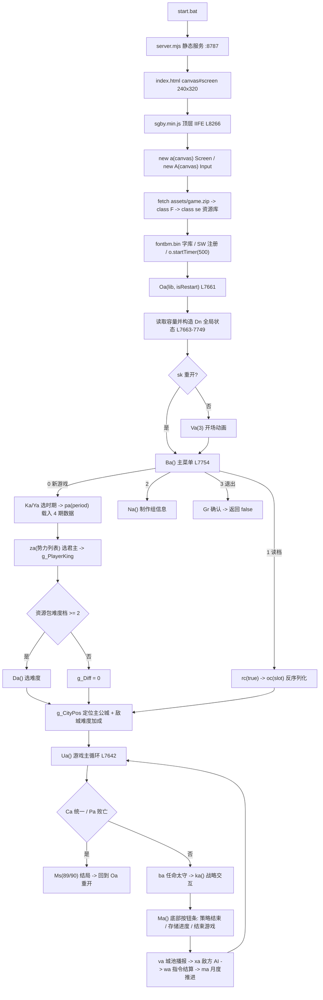
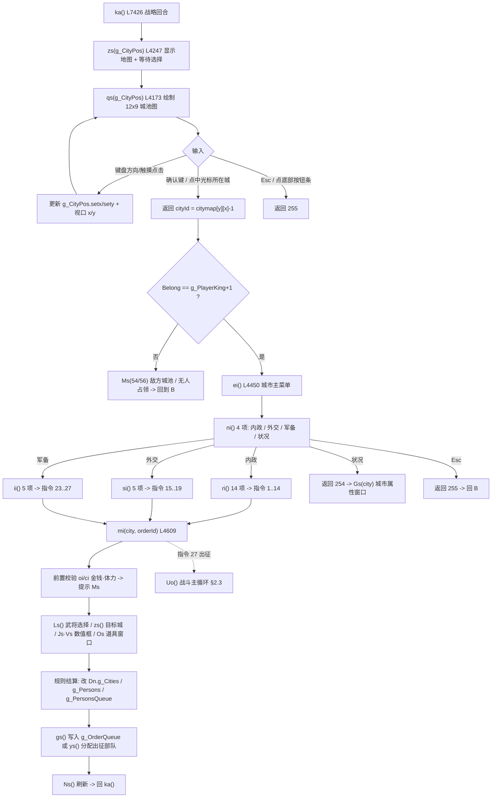
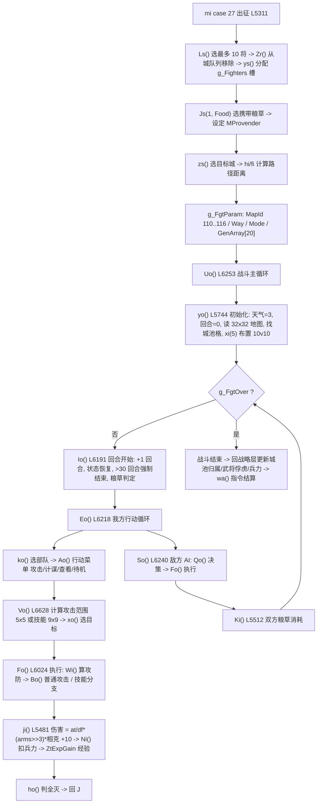
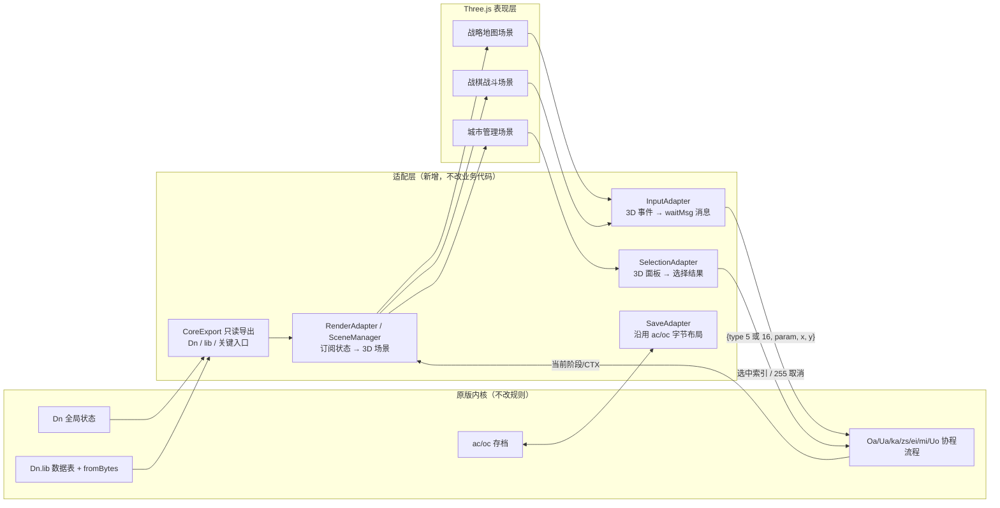

# P0｜《三国霸业》3D 重制 · 原版项目调研与实施规划

> 版本：P0（仅调研 / 仅规划，未改动任何业务代码）
> 分析日期：2026-11-06
> 分析对象：`D:/user_project/git/3d_games_explore/original/`
> 交付约束：只分析、不引入 Three.js、不删改原版模块、不虚构数据、不假设接口存在

---

## 0. 结论摘要

### 0.1 一句话结论

`original/` **不是步步高字典的原生二进制 ROM**，而是「三国霸业 v1.1.0 网页版」——一个把 **9688 版原版资源**（`manifest.json.source`）用 **纯 TypeScript/JavaScript 重写**后、经 esbuild 压缩成**单文件** `site/sgby.min.js` 的 Web 复刻。游戏规则、数据、渲染、UI 全部挤在这一个 199,653 字节的压缩文件里；规则数据以 JSON 表形式放在 `site/assets/game.zip`。

因此「保留原版逻辑 + 换 Three.js 表现层」在技术上是**可行但非即插即用**：逻辑与 240×320 四色 LCD 绘制、异步输入协程深度耦合，且**当前仓库没有可读源码、没有任何模块导出**。

### 0.2 八条关键结论

| # | 结论 | 主要依据 |
|---|---|---|
| 1 | 全局游戏状态是**单个闭包对象 `Dn`**，城市/武将/战斗/回合全在里面；无 store、无事件总线 | `sgby.pretty.js` L2415 `const Dn={...}`；`Oa()` L7663 初始化 |
| 2 | 城市 **38 座**、**4 个剧本时期**（190/198/208/225 年），名称表 `strings.json.城市名` 38 项 | `struct/城市数据.json`；`Oa()` L7665 用 `(len(57)-2)/37` 反推城市数 |
| 3 | 战略地图坐标 = **12×9 逻辑格**（`界面常量.城市布局`），**不是像素坐标**；绘制时缩放为 20px/格 | `qs()` L4178 `KW=Math.floor(Oe/fn)=240/12=20`；`城市坐标` 38 对与布局表 100% 一致（已脚本比对） |
| 4 | 城际连接是**独立数据表**，不是动态计算；运行时**只读右表（资源 59）**，左表（资源 60）从未被 `getItem` 引用 | `us()` L3381、`hi()` L4566、L7142 均 `getItem(59,1)`；全文 `getItem(60` 命中 **0** |
| 5 | 战斗地图 **7 张、每张 32×32 格**；视口 15×17 格、每格 16×16px；伤害/移动/攻击范围均有明确公式与数据表 | `struct/战斗地图1..7.json` 头部 `[32,0,32,0,...]`；`eo()` L5632、`Vo()` L6628、`ji()` L5481、`qi()` L5524 |
| 6 | 存档是 **2 片 base64 二进制**（`SGB3` + v4），**不含任何战斗状态、不含 UI/绘制状态**；替换渲染层不会破坏存档 | `ac()` L8185、`oc()` L8128、`Wn/Kn/Nn` L2456-2469 |
| 7 | 输入是**协程式 `await l.input.waitMsg()`**，逻辑函数内部直接调用绘制与菜单；不是 rAF 主循环驱动 | `zs()` L4287、`ei()` L4454、`$r()` L2952、`Ls()` L3715；rAF 仅用于 `screen.flush()` L8356 |
| 8 | 网页版**已改动若干原版规则**（搜索概率、战斗经验、地图铺满、彩蛋武将、难度档、天意赏赐），存在「哪个才是原版权威」的口径问题 | `/*SGBY_SEARCH_PROB*/` L6920、`/*SGBY-EXP*/` L6349、`/*SGBY-MAP-ENHANCE*/` L4174、`/*SGBY-GRANT*/` L3915 |

### 0.3 三个必须在 P1 前决策的阻塞项

1. **「原版」口径**：本仓库唯一可运行代码是网页版 `sgby.min.js`，但它含上述补丁；注释还引用了仓库里不存在的 `winform/Scenes/BattleScene.cs`、`src/data/pconst.js`、`tools/exp_logic.mjs`（L6351、L755、L6356）。需确认以「当前网页版运行行为」还是「9688 原版」为规则基准。
2. **内核可访问性**：`sgby.min.js` 是 IIFE 风格单文件，**无 `export`**，`Dn`/`mi`/`zs` 全部在闭包内，外部 JS 无法 import。适配层要么取得原始源码，要么对 bundle 做一次性只读导出注入，要么退化为黑盒 DOM 事件桥接。三者影响 P1~P7 全部工作量（详见 §6.5、§10 Q1/Q2）。
3. **「表现层重构」边界**：原版 240×320 四色 LCD 绘制与规则计算写在同一个函数里（例 `mi()` 的 `case 1` 内同时做 `Ns()` 清屏、`Ls()` 选将、金钱扣减、农业增长），不存在干净的纯逻辑层可分。P1 必须先做「规则/表现边界测绘 + 回归夹具」，否则 P2 之后必然改写规则。

### 0.4 分析范围与方法（可复现）

| 项 | 说明 |
|---|---|
| 扫描范围 | `original/` 全部 14 个文件；`docs/`（空）、`LICENSE`、`.gitignore` 已检查。**未发现其它可参考的三国霸业项目源码或文档** |
| 代码还原 | `sgby.min.js`（176 行 / 199,653 B）为 esbuild minify 产物。用词法感知脚本（不改写 token，仅在字符串/模板/注释/正则之外插入换行与缩进）还原为 **8,610 行**；`node --check` 通过 |
| 行号约定 | 下文 `L####` 一律指还原副本 `sgby.pretty.js`。**每个引用同时给出函数名与字符串常量**，可直接在 `original/site/sgby.min.js` 中检索定位 |
| 资源解包 | `game.zip` 文件名是 GBK 编码，已按 `cp437→gbk` 解码；解出 436 条目（5 root JSON + 375 pics + 36 spe + 20 struct） |
| 中间产物 | 仅存于系统临时目录 `%TEMP%/sgby_p0/`（`sgby.pretty.js`、`beautify.py`、`pack/`），**未写入仓库、未修改 original/** |
| 校验方式 | 城市坐标与布局表逐项比对（38/38 一致）、连接表边数统计、战斗地图尺寸/取值统计、存档字节长度反算 |

---

## 1. 项目结构分析

### 1.1 目录与文件职责（全部经代码核对）

| 路径 | 大小 | 实际职责 | 核对依据 |
|---|---:|---|---|
| `original/使用说明.txt` | 1,304 | 玩家说明：WASD/E/Q/F/M 键位、云存档、天意赏赐、Node 18+ | 全文；键位与 `M` 常量 L332 一致 |
| `original/start.bat` | 2,115 | 探测端口 8787 → 启动 `node server/server.mjs` → 自动开浏览器；含失败分支 | L11-81；`SGBY_OPEN=1` |
| `original/build-info.json` | 344 | 产物元数据：name/slug/version **1.1.0**/platform web/builtAt 2026-11-05、packSha1、436 entries、13 files | 全文；与 `pack.meta.json` sha1 一致 |
| `original/server/server.mjs` | 21,950 | **零第三方依赖** Node HTTP 服务：静态托管 `site/`（gzip/ETag/Range/URL 指纹注入）、`/api/health`、`/api/pack`、`/api/saves` CRUD + 历史版本 | L22-29、L202-220（VERSIONED 指纹）、L339-467、L541-594 |
| `original/site/index.html` | 2,120 | DOM 骨架：`<canvas id="screen" width="240" height="320">`、状态栏、触屏方向键；`<script type="module" src="sgby.min.js">` + `local-bridge.js` | L13、L26-35、L38-39 |
| `original/site/style.css` | 5,607 | 页面/缩放/虚拟按键/网页菜单 `.wm-panel` 样式；canvas `image-rendering:pixelated` | L34-44、L112-168 |
| **`original/site/sgby.min.js`** | **199,653** | **游戏本体**：资源包解析（zip/PNG/2bpp 索引色）、4 色 LCD 渲染器、输入管理、数据表装载、全部游戏规则、全部 UI、存档 | 见 §1.2 模块地图 |
| `original/site/local-bridge.js` | 14,287 | 不触碰主脚本：挂载「云存档」DOM 面板、把 `sgby.sangoN.sav` 搬到本地服务端；往游戏菜单插「天意赏赐」一节并调用 `window.SGBY_GRANT` | L13-16（存档键规则）、L244-330、L248-269 |
| `original/site/sw.js` | 1,242 | Service Worker，只缓存 `game.zip` / `fontbm.bin` / `fontbm-full.bin` 三个大资源 | L19-31 |
| `original/site/config.json` | 237 | `pack` 地址；留空 = `assets/game.zip`，可用 `?pack=` 覆盖 | L2-3；`server.mjs` L8368 读取 |
| `original/site/assets/game.zip` | 6,372,980 | 资源包（**store 模式无压缩 zip**），436 条目 | `class F._parseCentral` L566-591；`pack.meta.json` |
| `original/site/assets/pack.meta.json` | 122 | `{file,size,entries:436,sha1}` 指纹 | 全文 |
| `original/site/assets/fontbm.bin` / `fontbm-full.bin` | 540,430 / 1,145,698 | 点阵字库（含 CJK 全字库），`kr(bt(...))` 装载 | L8567-8571 |
| `docs/` | 空 | 本阶段输出目录 | `find docs` |

> 启动链路：`start.bat` → `server/server.mjs`（127.0.0.1:8787）→ `index.html` → `sgby.min.js` 顶层 IIFE（L8266）→ `fetch("assets/game.zip")` → `class F` 解析 → `class se` 建资源库 `Dn.lib` → `Oa()` 进入游戏。`local-bridge.js` 是旁挂增强，不参与主流程。

### 1.2 `sgby.min.js` 模块地图（按还原副本行号）

| 区段 | 内容 | 代表符号 |
|---|---|---|
| L1-286 | 10 组四色调色板 + **`class a`（Screen）**：240×320 LCD、精灵绘制、缩放、脏标记、`drawPic/drawPicScaled/drawPicEx/blitScaled/rect/revlcd/clrlcd` | `const t=240,e=320,n={lcd,mono,amber,...}`；`class a` L55 |
| L287-331 | 全局引擎对象 `l={screen,disp,runErr,input,engine}` + 触摸手势工具 `u/f/h/g/d/y` | L291-296 |
| L332-553 | **`class A`（输入管理器）**：键盘映射 `M`、指针事件 → 240×320 虚拟坐标、`waitMsg()/gamDelay()/waitMsgTimeout()` | `M` L332；L397-400 `Math.floor((clientX-left)/width*240)` |
| L554-2234 | fflate/PNG 解码、zip 读取 `class F`、**资源库 `class se`**（`getItem/getConst/getIface/getStr/loadPic/itemCount/resId`） | `class F` L554；`getConst` L2123；`getItem` L2113 |
| L2235-2344 | 资源加载 `ie()`、IndexedDB MOD 包缓存、跨域 iframe 桥接 | L2235、L2269-2344 |
| L2345-2452 | 游戏常量、数据类 **`Un`(武将 19B) / `On`(城市 37B) / `Bn`(指令 14B)**、全局状态 `Dn` | L2351-2369、L2370/2385/2400、L2415 |
| L2453-2687 | 存档键 `jn()`、v3/v4 头校验、base64 工具、网页菜单（MOD/存档导入导出/关于） | `Xn="sgby.sango"` L2453；`Rn=[83,71,66,51]` L2455 |
| L2688-3240 | 数据表装载、通用 UI：`$r()` 滚动菜单、`Gr()` 确认框、`Ur/Or` 文本、`Xr/Yr/Ms` 提示 | `$r` L2952、`Gr` L3042 |
| L3241-3810 | **查询/筛选层** `ss/is/ns/cs/fs/hs/Vr/Zr/gs/ds/ys` + **属性显示模块 `Xs`**（城市/武将/道具） | `ss` L3315、`fs` L3383、`Xs` L3810 |
| L3810-4172 | 按钮条 `Rs/Ns`、**地图增强补丁 `ZtTint`**、**天意赏赐补丁 `ZtEnsure/ZtKingCity/SGBY_GRANT`** | `/*SGBY-MAP-ENHANCE*/` L3838、`/*SGBY-GRANT*/` L3915 |
| L4173-4446 | **战略地图绘制 `qs()`**、**城市点击/选择 `zs()`**、形势图、城市属性模块 `ti` | L4173、L4247、L4446 |
| L4446-5368 | **城市菜单 `ei/ni/ri/si/ii`** + **指令执行 `mi()`**（27 个 case）+ 路径计算 `fi/hi` | L4450、L4609 |
| L5369-6660 | **战斗系统**：地图/地形/部队/移动范围/攻击范围/伤害/技能/AI/回合 | `Uo` L6253、`qi` L5524、`ji` L5481 |
| L6660-7213 | 指令月度结算 `_a()`、AI 城池行动 `Fa/Ea/Ia/Sa`、搜索/招降 | `_a` L6913 |
| L7213-7641 | **回合推进 `wa/ma`**、时期装载 `pa`、太守任命 `ba`、胜负 `Pa/Ca`、战略回合 `ka/Ma`、战斗经验补丁 | `wa` L7213、`ma` L7219、`Ua` L7642 |
| L7642-8106 | **主循环 `Oa/Ua`**、主菜单 `Ba`、难度 `Da`、时期 `Ka`、君主 `za`、存档界面 `rc` | L7661、L7754 |
| L8106-8238 | **存档序列化 `ac()` / 反序列化 `oc()`** | L8185、L8128 |
| L8239-8611 | 引擎对象、启动 IIFE、缩放、SW 注册、资源加载、**外层「重开一局」循环** | L8266、L8580-8600 |

### 1.3 `game.zip` 内容（436 条目）

| 类别 | 数量 | 说明 |
|---|---:|---|
| 根 JSON | 5 | `manifest.json`（资源 ID 目录）、`pack.json`、`pics.json`（图片图集规格 wid/hig/count/mask/bpp）、`spe.json`（特效帧序列）、`strings.json`（全部界面文本） |
| `struct/` | 20 | 城市数据、城市连接右/左、武将数据、武将出现、武将队列、将领专长技能、道具数据/出现/队列、技能数据/范围、界面常量、战斗地图 1-7 |
| `pics/` | 375 | 30 张图集 PNG + 345 张武将头像分文件；含 `*_mask.png` 遮罩；2bpp 索引色 |
| `spe/` | 36 | 开场动画、6 兵种特效、火攻/水淹/滚木/石阵/陷阱、主菜单与时期图标 |

`manifest.json` 定义 **87 个资源 ID**（`type=string|struct|pic|spe`）。关键 ID：

| ID | 名称 | ID | 名称 |
|---:|---|---:|---|
| 1 | 界面字符串（70 条） | 2 | 界面常量（15 项） |
| 10 | 技能数据（30×34B） | 13 | 技能范围（30×9×9） |
| 44/45/46 | 主菜单/时期/存档背景图 | 54/55/56 | 城市地图图块(32px×108帧) / 城市图标(16px×10帧) / 城市光标 |
| 57 | 城市数据（4 时期） | 58 | 城市名（38） |
| 59 / 60 | 城市连接右 / 左 | 61 | 武将数据（4 时期 ×200） |
| 62/70/71/72 | 武将名 1-4（各 200） | 63/65 | 武将出现 / 武将队列 |
| 64 | 字符串常量（163 条，菜单文本） | 66/67/68 | 道具数据(33) / 出现 / 队列 |
| 75 | 战略图 | 76 | 兵戎提示图 |
| 110-116 | 战斗地图 1-7 | | |

> `getConst(n)` = `getStr(64,n)` = `strings.json.字符串常量[n-1]`（**1-based**，L2123-2125）；`getIface(n)` = `getStr(1,n)`（L2126-2128）；`getItem(id,idx)` = 第 `idx` 项（1-based，L2113-2117）。这一索引语义已用菜单文本逐项验证通过。

---

## 2. 游戏调用关系（Mermaid）

### 2.1 启动与主流程



### 2.2 城市 → 城市管理 → 指令



### 2.3 战斗主循环



### 2.4 完整流程逐步对照表（任务 2）

| 步骤 | 函数（还原副本行号） | 数据结构 |
|---|---|---|
| 启动 / 资源装载 | IIFE L8266、`ie()` L2235、`class se` L2028 | `Dn.lib` |
| 状态初始化 | `Oa()` L7661 内匿名函数 L7663-7749 | `Dn`（`g_Persons[200]`、`g_Cities[38]`、`g_OrderQueue[100]`、`g_GenPos[20]`、`citymap[9][12]`） |
| 开场动画 / 主菜单 | `Va(3)`、`Ba()` L7754、`Ya(44,100,Ta,false)` L7849 | 资源 44 主菜单背景、`Ta` 4 个矩形 |
| 选剧本（4 时期） | `Ka(t)` L7883 / `Ya(45,104,La,true)`、`pa(period+1)` L7349 | `getItem(57,t)` 城市数据、`getItem(61,t)` 武将数据、`getItem(65,t)` 队列 |
| 选君主 / 难度 | `za(t)` L7982、`Da(len)` L7795 | `g_PlayerKing`、`g_Diff`、`diffs[]` |
| 战略地图 / 选城 | `zs()` L4247 ↔ `qs()` L4173 | `g_CityPos{x,y,setx,sety}`、`citymap`、`界面常量[14] 城市布局` |
| 城市管理 | `ei()` L4450 → `ni/ri/si/ii` → `Gs()` L3775 | `getConst(37..40)` 菜单文本 |
| 武将操作 | `Ls()` L3686、`Ds/Ts` L3662/3672、`ss/is/os/as/ls` | `g_Persons[]`、`g_PersonsQueue[]` |
| 战略行动（27 指令） | `mi()` L4609、`fi/hi` L4538/4565、`gs/ds/ys` | `Bn` 指令对象、`g_OrderQueue[100]`、`g_Fighters[300]` |
| 战斗 | `Uo()` L6253 → `yo/Io/Eo/So/Fo/Qo/Bo` | `g_FgtParam`、`g_FightMap[285]`、`g_FightPath[250]`、`g_FgtAtkRng[86]`、`g_GenPos[20]`、`g_GenAtt[2]` |
| 战斗结算 | `ho()` L5715、`Oo()` L6259、`_a()` L6913 | 城池 `Belong`、武将 `Belong=65535`（俘虏）、`Arms` |
| 回合推进 | `wa()` L7213（逐条结算指令）、`ma()` L7219（月+1、年龄、粮饷、灾害）、`xa()` L7481（AI 势力） | `g_MonthDate/g_YearDate`、`g_Cities[].Id` 状态 |
| 存档 | `Ma()` case 1 → `l.engine.gamRecordMan(0)` L7460 → `rc()` L8064 → `ac()` L8185 | 2 片 localStorage |
| 胜负 / 重开 | `Ca()` L7423、`Pa()` L7420、`Ua()` L7642、外层 L8580 | `ns()/cs()` 城池与势力列表 |

---

## 3. 原版数据结构（真实字段，非推测）

### 3.1 运行时数据类（`fromBytes/toBytes`，即存档字节布局）

**`Un` 武将 / Person — 19 字节**（L2370-2384）：

| 偏移 | 字段 | 类型 | 说明 |
|---:|---|---|---|
| 0 | `Id` | u16 | 运行时标记（出征等） |
| 2 | `Belong` | u16 | 归属 = **君主武将编号+1**；`0` 在野、`65535` 俘虏 |
| 4 | `Level` | u8 | 等级 |
| 5/6 | `Force` / `IQ` | u8 | 武力 / 智力 |
| 7 | `Devotion` | u8 | 忠诚 |
| 8 | `Character` | u8 | 性格（影响 AI 劝降率表，`xa()` L7492） |
| 9 | `Experience` | u8 | 经验（≥阈值升级） |
| 10 | `Thew` | u8 | 体力（指令消耗 `Ye[orderId]`） |
| 11 | `ArmsType` | u8 | 兵种 0-5（骑兵/步兵/弓兵/水军/戟兵/玄兵） |
| 12 | `Arms` | u16 | 兵力 |
| 14/16 | `Equip[2]` | u16×2 | 道具编号+1 |
| 18 | `Age` | u8 | 年龄 |

**`On` 城市 / City — 37 字节**（L2385-2399）：

| 偏移 | 字段 | 类型 |
|---:|---|---|
| 0 | `Id` | u8（**城市状态**：0 正常 / 1 饥荒 / 2 旱灾 / 3 水灾 / 4 暴动，`$s()` L3754 用 `getConst(12+Id)`） |
| 1 | `Belong` u16 · 3 `SatrapId` u16 | 归属 / 太守（武将编号+1，0 无） |
| 5/7/9/11 | `FarmingLimit` / `Farming` / `CommerceLimit` / `Commerce` | u16×4 |
| 13/14 | `PeopleDevotion` / `AvoidCalamity` | u8×2（民忠 / 防灾） |
| 15/19 | `PopulationLimit` / `Population` | u32×2 |
| 23/25/27 | `Money` / `Food` / `MothballArms` | u16×3（金钱 / 粮食 / 后备兵力） |
| 29/31 | `PersonQueue` / `Persons` | u16（**全局武将队列的起始下标与数量**） |
| 33/35 | `ToolQueue` / `Tools` | u16（全局道具队列） |

**`Bn` 指令 / Order — 14 字节**（L2400-2414）：`OrderId(u8, 255=空) · Person(u16) · City(u8) · Object(u16) · Arms/Food/Money(u16×3) · Consume(u8) · TimeCount(u8)`。`Aa()` L7496 返回同构字面量。

> ⚠️ **数据表说明文字与运行实现不一致**：`struct/城市数据.json.说明` 写「CityType 31 字节 × 38 城」，`struct/武将数据.json.说明` 写「PersonType 15 字节 × 200 武将」，但 `On.fromBytes` 用 **37**、`Un.fromBytes` 用 **19**，`Oa()` L7665 也按 `(len(57)-2)/37` 与 `len(61)/19` 反推容量。**以 `fromBytes` 为准**，JSON 说明字段是旧版残留。

### 3.2 全局状态 `Dn`（L2415-2424）

```
lib, g_PlayerKing, g_YearDate, g_MonthDate, g_PIdx(时期索引),
g_LookEnemy, g_LookMovie, g_MoveSpeed,
g_Persons[200] : Un, g_Cities[38] : On,
g_PersonsQueue : Uint16Array(200), g_GoodsQueue : Uint16Array(33),
g_OrderQueue[100] : Bn, g_FightersIdx : Uint8Array(30),
g_Fighters : Uint16Array(300)   // 30 槽 × 10 字（每槽 10 名出征武将）
g_CityPos {x,y,setx,sety}, g_Diff, diffs[],
g_FgtAtkRng : Uint8Array(86), g_FightPath : Uint8Array(250),
g_FightMap : Uint8Array(285), citymap[9][12],
g_FgtParam {Mode, MProvender, EProvender, MapId, Way, GenArray:Uint16Array(20)},
g_FgtOver, g_GenPos[20], g_GenAtt[2],
g_MapSX/g_MapSY/g_MapWid/g_MapHgt, g_FoucsX/g_FoucsY,
g_CityX/g_CityY, g_MainGenIdx, g_FgtWeather, g_FgtBoutCnt,
g_EneTmpProv, g_PathSX/g_PathSY, g_PUseSX/g_PUseSY,
g_BakUpX/g_BakUpY, g_TileId, cavpdb, cavps
```

`g_GenPos[i] = {x,y,hp,mp,move,active,state}`（L7733-7736），`state` 取值见 `Io()` L6206-6212：`0/5` 正常、`1/2/3` 异常、`4/7` 状态类、`6` 混乱（掉兵）、`8` 不在战场。
`g_GenAtt[0/1] = {person,level,canny,ter,bile,armsType,exp,arms,at,df}`（L7737-7743，由 `Wi()` L5490 填充）。

### 3.3 城市系统（任务 3 答案）

| 项 | 实测值 | 出处 |
|---|---|---|
| 城市总数 | **38**（ID 0-37） | `strings.json.城市名` 38 项；`界面常量.城市坐标` 38 对；`Oa()` 反推 38 |
| 剧本时期 | **4**：190 / 198 / 208 / 225 年，每期 38 城 | `struct/城市数据.json.时期[].年份` |
| 城市名称 | 0 西凉、1 北平、2 襄平、…、37 建宁 | `strings.json.城市名` |
| 逻辑坐标 | 12 列 × 9 行，`x∈[0,11] y∈[0,7]` | `界面常量.城市坐标` |
| 城市布局表 | `界面常量[14]` 9×12，值 = 城市编号+1，0 空格 | `qs()` L4179 `getItem(2,14)` |
| 一致性 | 38/38 城市的布局表位置 == 城市坐标表（脚本逐项比对通过） | — |
| 连接表 | `城市连接右`（资源 59）38×16B：8 方向连接值(=城号+1,0 无) + 8 方向距离；`城市连接左`（资源 60）同规格 | `struct/城市连接右/左.json`；`B` 定义 L624-647 |
| 边数统计 | 右表 108 有向 / **54 无向**；左表 182 有向 / **99 无向**；两表并集 **103** 无向边，交集 50 | 脚本统计 |
| **实际生效** | 代码只 `getItem(59,1)`（L3381 `us`、L4566 `hi`、L7142），**左表 60 全文未被调用** | `getItem(60` 命中 0 |
| 所属势力 | `Belong` = 君主武将编号+1；`0` = 空城 | `ns()` L3297、`cs()` L3362、`qs()` L4198 |
| 时期 0 分布 | 空城 13 座，19 个势力值（1-19），最多的势力占 3 城 | `城市数据.json.时期[0]` 统计 |
| 城市资源 | 农业/商业（含上限）、民忠、防灾、人口（含上限）、金钱、粮食、后备兵力、人才队列/数、道具队列/数 | `On` 字段 + JSON 城市样例 |
| 城市武将 | **不在城市对象里**，靠 `PersonQueue + Persons` 索引到全局 `g_PersonsQueue` | `Vr()` L3241、`Zr()` L3253、`ss()` L3315 |
| 城市状态 | `Id` 0-4 → 正常/饥荒/旱灾/水灾/暴动 | `$s()` L3754、`ma()` L7304-7313 |
| 城市操作入口 | `zs()` 返回城号 → `ka()` 判归属 → `ei()` 菜单 → `mi(city,orderId)` | L4299/L4301、L7432-7446 |
| 城市地图 id | `界面常量[15]` 38 项（0-6），决定战斗用哪张地图 | `L7141` `MapId = 110 + (id+1) - 1` |
| 城池图标帧 | `fr = 我方?8 : 敌方?7 : 0`（空城/我方/敌方**三态不同图标**），再经 `ZtTint` 染色 | `qs()` L4198-4205 |

**坐标是否直接用于绘制：否。** 城市坐标是**逻辑格 (col,row)**，绘制经过两级转换：

1. `城市布局[col,row] → 城市编号+1`（`qs()` L4196 `c[row][col]`）
2. `屏幕像素 = (KW*col, OY+KH*row)`，其中 `KW=KH=⌊Oe/fn⌋=⌊240/12⌋=20`px，`OY=⌊(294-hn*KH)/2⌋=57`px（L4178、L4191）
3. 图块帧索引 `d*((t.y+row)*fn+col)`（L4191），`t.y` 为纵向视口偏移；水平视口 `a` 为 0..144px（L3833 `Ws()=fn*gn-Oe=12*32-240=144`）
4. 城市图标再缩放：`iw=⌊KW*0.625⌋=13`px，居中偏移 `((KW-iw)>>1)`（L4201）

**连接路径是独立数据还是动态计算：两者都有，分工明确。**
- 独立数据：8 方向邻接 + 距离写在资源 59 的 16 字节/城（`us()` L3380-3382）；`fs(city)` 取同势力邻接城、`hs(city)` 取敌对邻接城（L3383-3398），`hi()` 用连接表查相邻城与距离（L4565-4572）。
- 动态计算：`fi()` L4538 在 `fs()` 基础上做**同势力连通图 BFS**（去重、求曼哈顿距离），用于输送/移动到非邻接己方城。
- 注意：`城市连接左.json` 存在于资源包但**运行时不读取**，其语义（可能是反向/单向通路）需确认（§10 Q6）。

### 3.4 武将 / 势力 / 道具

| 项 | 值 | 出处 |
|---|---|---|
| 武将数 | 200（每时期 200 条） | `Oa()` L7665 `len(61)/19`；`struct/武将数据.json` |
| 名字表 | 4 组 ×200（`武将名1..4`，随时期切换 `Tn` L2425、`Ln()` L2426） | `strings.json` |
| 出现条件 | `出生年 + 16 = 登场年`、`搜索者`(0=任何人)、`出现城市` | `武将出现.json.说明`；`_a()` case 3 L6917 |
| 专长技能 | 每时期 200 字节技能编号 | `将领专长技能.json`；资源 14 |
| 势力 | 无独立势力表；**势力 = 君主武将**，`Belong = 君主武将 index + 1`；玩家 `g_PlayerKing` 也是武将 index | `za()` L7982、`ns()` L3297、`$n()` L2435（取名字） |
| 空城 / 俘虏 | `Belong=0` 空城；武将 `Belong=65535` 俘虏（`is()` L3325）；在野 `Belong=0` | L3331、L6934 |
| 道具 | 33 个，66 字节/个（武力/智力/移动加成、兵种改变） | `道具数据.json`、`道具名/说明` |
| 兵种 | 6 种：骑兵/步兵/弓兵/水军/戟兵/玄兵；可扩展至 61（`xe=6` 当前） | `界面常量.兵种技能表`、`strings.界面字符串[11]`、`Oa()` L7671 |

### 3.5 战斗系统数据（任务 5 答案）

| 项 | 实测 | 函数 / 出处 |
|---|---|---|
| 地图数量 | **7** 张（资源 ID 110-116） | `manifest.json`、`struct/战斗地图1..7.json` |
| 地图尺寸 | **32×32 格**，头部 16 字节 `[32,0,32,0,4,0,...,77,80]`；运行时 `g_MapWid=t[0]=32, g_MapHgt=t[2]=32` | `yo()` L5755；脚本统计 7 张均 32×32 |
| 图块值 | = 图块编号+1，取值 1..46（对应 `战斗地图图块` 46 帧、16×16px） | `pics.json.战斗地图图块`、`manifest` ID 4 |
| 地形类型 | **8 种**：草地/平原/山地/森林/村庄/城池/营寨/河流 | `strings.界面字符串[6]`；`Ui(x,y)` L5411 图块→地形映射 |
| 地形映射规则 | `r>15 ? (r==41?6:7) : r>5?2 : r>4?3 : r>3?4 : r>2?5 : r>1?0 : 1` | `Ui()` L5414-5415（**纯规则**，不含绘制） |
| 视口 | 15 列 × 17 行（`pe=15, be=17`），每格 16×16px；`eo()` 把 `g_FightMap[255]` 绘制成 240×272 | `eo()` L5632-5654、`to()` L5628 |
| 部队 | 最多 **20 支部队**（我方 0-9 / 敌方 10-19，`_e=10, we=20`）；`g_Fighters` 30 槽×10 名出征武将 | L2351-2356、`ys()` L3414 |
| 初始布阵 | `xi(5)` 战斗初始坐标表 9 行 ×20 列，按 `g_FgtParam.Way` 选行 | `yo()` L5763-5768 |
| 移动力 | `yn=[5,4,4,5,6,3,...]`（6 兵种）+ 装备移动加成，**上限 8** | `Ri()` L5461-5479、L2357 |
| 移动范围 | 15×15 局部窗口（225 格）：读地图 → 按兵种查 `地形移动消耗[46]` → BFS 扩散 `Hi()` → 其他部队格标 254 阻挡、邻接格 `\|=160` | `qi()` L5524-5589、`zi()` L5590 |
| 攻击范围 | 普通攻击 **5×5** 位图，按兵种从 `界面常量[1] 兵种攻击范围` 取 25 格；技能 **9×9**，从 `技能范围` 取 81 格 | `Vo()` L6628-6644、`_o()/Ho()` L5784/L6620、`wo()` L5788 高亮 |
| 攻防属性 | `at=⌊Force×(Level+10)×atk[ArmsType]⌋ >> 地形战力[8×ArmsType+ter]`；`df` 同理用 IQ 与 df 系数，再乘 `terrDf[ter]` | `Wi()` L5490-5511 |
| **伤害公式** | `dmg = trunc( (at/df) × (arms>>3) × 兵种相克[atType][dfType] + 10 ) & 0xFFFF`，`Ni()` 扣兵力 | `ji()` L5481-5488、`Bo()` L6290 |
| 相克系数 | 资源包 `界面常量[19]` 或用内置 `_n[6][6]`（L2357）；当前包只有 15 项 → **回退内置系数** | `Gi()` L5443-5448、`ji()` L5484-5487 |
| 技能 | 30 个（`技能名` 30 条），每技能 34B 效果 + 9×9 范围；天气/地形/敌兵种加成均数据驱动 | `技能数据.json`、`技能范围.json`、`Xi()` L5450 |
| 行动状态 | `g_GenPos[].active`（本回合已行动）、`.state`（0-8）、`.move`、`.hp/.mp`；菜单 `攻击/计谋/查看/待机` | `Ao()` L6000、`Io()` L6191 |
| 回合 / 天气 | `g_FgtBoutCnt`（>30 强制结束）、`g_FgtWeather`（5 种：晴/阴/风/雨/冰） | `yo()` L5744、`Io()` L6192 |
| 粮草 | 每回合 `Ki()` 按 `⌊sqrt(总兵)/3⌋` 扣双方粮草，归零即败 | `Ki()` L5512、L6198 |
| 结束条件 | `g_FgtOver`：一方全灭（`ho()` L5715）、粮草耗尽、>30 回合、主动撤退、主将败退 | `Uo()` L6253、`yo()` L5750、`Io()` L6192 |
| **规则 vs 绘制边界** | 规则：`qi/ji/Wi/Vo/Ui/Oi/Ri/Ki/ho/_a/Qo`；绘制/交互：`eo/to/wo/mo/bo/Do/qr/Mi/Zi/Yr/Ns`；**混合**：`Fo/Ao/Eo/So/Io/yo/Uo`（既改状态又 `await` 绘制/输入） | 见 §4、§5 |

### 3.6 存档系统（任务 6 答案）

| 项 | 实测 |
|---|---|
| 存储 | `localStorage`，**3 槽 × 2 片**；键 `sgby.sango{2*slot}.sav` / `sgby.sango{2*slot+1}.sav`；`?save=xxx` → 前缀 `sgby.sango.xxx`（`jn()` L2456、L8246-8252） |
| 编码 | `btoa/atob` 的 base64（`qn/zn` L2470-2483）包装二进制 |
| 头 | 5 字节：`"SGB3"` (`Rn=[83,71,66,51]`) + `version=4`；`Kn()` 校验，旧版存档直接拒绝（L2462-2465） |
| **base 片** | `35 + 19*Ae + 2*Ae + 2*Ie` 字节 = `35 + 3800 + 400 + 66 = 4301` B（当前容量）。偏移 5 起：`g_PIdx, g_PlayerKing(u16), g_YearDate(u16), g_MonthDate, g_LookEnemy, g_LookMovie, g_MoveSpeed, g_CityPos{x,y,setx,sety}, g_Diff` 共 14B → 4×u32 容量(Ae,Fe,Ie,Ee) → `g_Persons[200]`×19B → `g_PersonsQueue`×2B → `g_GoodsQueue`×2B |
| **dyn 片** | `2035 + 37*Fe` = `2035 + 1406 = 3441` B。偏移 5 起：`g_FightersIdx[30]` → `g_Fighters[300]`×2B → `g_OrderQueue[100]`×14B → `g_Cities[38]`×37B |
| 校验 | `Nn()` L2466 校验武将/城市/道具/技能数与当前资源包一致；`oc()` 还校验难度档数（L8140） |
| 读档流程 | `Ba()` case 1 → `rc(true)` L8064 → `oc(slot)` L8128 → `zn()` 解码 → `Kn/Nn` → `Un/On/Bn.fromBytes` 直接写回 `Dn` → 返回 `true` 开始 `Ua()` |
| 存档槽摘要 | `Hn()` L2484 只读 base 片头取 `king/year`；`sc()` L8106 显示「君主名 + 年份」 |
| **战斗状态** | ❌ **完全不保存**：`g_FightMap/g_GenPos/g_GenAtt/g_FgtParam/g_FgtOver/g_FgtBoutCnt` 均不在序列化清单；战斗中也无存档入口（`Ma()` 只在战略地图底部按钮条可达） |
| **对 UI/绘制依赖** | ❌ **无**：序列化只调用 `Un/On/Bn.toBytes/fromBytes`、`localStorage`、`qn/zn`；提示文字经 `Yr(getIface(...))`，可替换实现 |
| 云存档 | `local-bridge.js` + `server.mjs` 只把 `parts:{key:string}` 原样搬运到 `data/saves/slot-N.json`，**不理解存档内容** |

**评估**：替换 UI 与渲染模块**不影响存档内容**，前提是 ① `Un/On/Bn` 字段与字节布局不变 ② `Ae/Fe/Ie/Ee` 容量不变 ③ 头 `SGB3`+v4 不变 ④ `?save=` 前缀规则不变。任何字段增删都会触发 `Nn()` 拒绝或静默写坏旧档。

---

## 4. 核心逻辑清单（必须原样保留）

> 判定标准：改动会改变游戏规则、数据或存档结果的模块。全部来自 `sgby.min.js`，括号为还原副本行号。

| 模块 | 关键函数 / 常量 | 为什么必须保留 |
|---|---|---|
| 资源装载与容量推导 | `Oa()` 内匿名初始化 (L7663-7749)、`class se.getItem/getConst` (L2113-2128)、`$` 数据表 schema (L755-802) | 决定 38 城/200 将/33 道具/30 技能/4 时期；改错即数据错 |
| 数据反序列化 | `Un/On/Bn.fromBytes/toBytes` (L2370-2414)、`B` 字段表 (L624) | 同时是**存档格式**；必须与旧档字节兼容 |
| 全局状态 | `Dn` (L2415) | 唯一状态源 |
| 时期 / 开局 | `pa()` (L7349)、`za()` (L7982)、`Ka()` (L7883)、`Ba()` (L7754) | 剧本数据、君主、初始城、难度 |
| 城市查询 | `ns/rs/ss/is/os/as/cs/ls` (L3297-3378)、`us/fs/hs` (L3380-3398)、`Vr/Zr/ts/es` (L3241-3296) | 武将筛选、邻接与队列维护 |
| 路径 | `fi()` (L4538)、`hi()` (L4565) | 输送/移动/出征距离 |
| 指令前置条件 | `oi/ai/ci/li` (L4502-4513)、`Ye/Ge` 消耗表 (L2355)、`mi()` 各 case 前置校验 (L4612-5368) | 金钱/体力/上限/人数限制 |
| 指令结算 | `mi()` 27 分支 + `_a()` (L6913) + `wa()` (L7213) | 全部内政/外交/军备结果 |
| 指令队列 | `Aa/gs/ds/ys/ws/_s` (L3400-3426, L7496) | 出征部队、多回合指令 |
| 回合与月度 | `ma()` (L7219)、`xa()` (L7481)、`Fa/Ea/Ia/Sa` (L7501-7641)、`ba()` (L7395) | 灾害/年龄/粮饷/AI/太守 |
| 胜负 | `Pa()` (L7420)、`Ca()` (L7423)、`Ua()` (L7642) | 游戏结束条件 |
| 战斗初始化 | `yo()` (L5744)、`Qi` 部队初始化、`xi(5)` 布阵、`Ci()` 地图 (L5374) | 战斗初始状态 |
| 战斗规则 | `Ri` 移动力 (L5461)、`qi/zi/Hi` 移动范围 (L5524-5617)、`Vo/Ho/_o` 攻击范围 (L6628/6620/5784)、`Wi` 攻防 (L5490)、`ji` 伤害 (L5481)、`Ni` 扣兵 (L5520)、`Ki` 粮草 (L5512)、`Ui` 地形 (L5411)、`Xi` 技能 (L5450) | 全部战斗算法 |
| 战斗流程 | `Uo/Io/Eo/So/Fo/Ao/Qo/Bo/ho/Oo` (L5744-6620) | 回合制、AI、状态机、结束条件 |
| 随机数 | `Gn()` (L2450) = `65536*Math.random()\|0` | 所有概率判定；替换会改变结果序列 |
| 存档 | `jn/Wn/Kn/Nn/qn/zn/Hn/Jn` (L2453-2503)、`ac()` (L8185)、`oc()` (L8128) | 存档兼容性 |
| 数据表 | `game.zip/struct/*.json` 全部 20 个 + `strings.json` | 规则数值唯一来源 |

**可以替换（表现层，不属于规则）**：`class a` Screen 全部绘制方法、`Fr/Ir/Er/Ur/Or/Br/Dr/Tr/Lr` 文本排版、`$r/Gr/Yr/Ms/Xr/Qr` 通用控件、`Qs/Rs/js/Ns` 按钮条、`qs()` 地图绘制段、`eo/to/wo/mo` 战斗绘制、`di/yi/_i/wi` 提示插画、`Ls/Ds/Ts/Os/Ss/Gs` 信息窗口的**展示部分**（其选中结果必须回传）。

**⚠️ 混合函数（不能直接删除，必须拆出结算部分）**：`mi()`（改状态 + `Ns/Yr/Ls`）、`zs()`（返回城号 + 清屏/按钮条/形势图）、`qs()`（绘制 + `ZtEnsure()` 插入彩蛋武将）、`Fo()/Bo()/Io()/yo()`（改状态 + 动画 + `await gamDelay`）、`ma()`（结算 + `xs()` 灾害提示）。

---

## 5. 渲染替换清单

| 原版绘制代码 | 位置 | 3D 重制处理 | 保留部分 |
|---|---|---|---|
| `class a` 240×320 四色 LCD 全部方法 | L55-286 | **替换**（3D 场景独立 canvas；原 canvas 可保留为调试/回退层） | 调色板 `n`、`packColor` 可留作纹理色调参考 |
| `qs()` 战略地图片段 | L4173-4245 | **替换**：12×9 平面 → 3D 地形 + 立体城市模型；`城市布局/城市坐标` 数据保留 | `citymap` 构建、城市三态帧选择逻辑、命中返回 `c[u][f]` |
| `zs()` 地图交互 | L4247-4349 | **替换交互实现**：Raycaster 点击 + 相机平移/缩放；保留 `waitMsg` 消息协议 | 键盘/触摸 → `g_CityPos` 更新逻辑、返回 `o-1` 的语义 |
| `Rs/js/Ns` 底部按钮条 | L3821-3837 | **替换**为 3D HUD（信息/查找/菜单） | `js()` 命中矩形可作为回退 |
| `eo/to/wo/mo` 战斗地图绘制 | L5628-5654、L5788-5833 | **替换**：32×32 格 → 立体格子 + 地形高度 + 3D 部队 | `g_FightMap` 视口切片逻辑、`Ji/Vi` 格→像素函数可留作对照 |
| `Qr/Mi/qr/Xr` 图片与特效播放 | L3073、L5384、L3141 | **替换**为 GLTF 模型 / 粒子 / Sprite | `spe.json` 帧时序数据（帧数、延迟）可复用 |
| `di/yi/_i/wi` 信息插画 | L4588-4608 | **替换**为 3D 面板 | 无 |
| `$r/Gr/Ls/Gs/Os/Ss` 菜单窗口 | L2952、L3042、L3686、L3775、L3576 | **替换 UI 外壳**（DOM/3D 面板），保留**选择语义与返回契约** | 选中索引、255=取消、分页/候选数组规则 |
| `Fr/Ir/Er/Ur/Or/Dr` 字体绘制 | L2886-2941 | **可保留**（继续用 `fontbm.bin` 做 2D 文字层，绘制到 HTML overlay） | 点阵字库与宽度表 `$e/Le` |
| 网页 DOM 菜单（MOD/云存档/关于） | L2509-2687、`local-bridge.js` | **保留**（与游戏规则无关，不属三大场景） | 全部 |
| 资源包解码 `class F/se`、PNG 2bpp 还原 | L554-2234 | **保留并复用**（3D 贴图仍需这些像素数据） | 全部 |
| `sw.js` 缓存白名单 | L21 | **需扩充**（新增 3D 资源） | 现有三项 |

> **旗帜差异已存在**：`qs()` L4200 `fr = mine?8 : foe?7 : 0` 已是「我方 / 敌方 / 空城」三态图标，3D 版应沿用同一 `Belong` 判定（`city.Belong===g_PlayerKing+1` / 非 0 / 0），不要另造规则。

---

## 6. 适配层设计建议（基于真实源码）

### 6.1 设计前提（必须承认的三条事实）

1. 原版是**协程式 UI**：`zs()/ei()/mi()/Ao()` 等函数内部 `await l.input.waitMsg()` 阻塞流程，逻辑与界面在同一调用栈。不存在「调用一个纯函数拿到结果」的接口。
2. `l.screen`（绘制）与 `l.input`（输入）是 `l` 对象上两个可替换的插槽（L291-296、L8268-8270）。**这是原版留给适配层唯一的官方缝隙**。
3. `window.__SGBY_CTX` 是网页版已埋的上下文钩子：`ka()` L7437-7445 在调用 `mi()` 前设置 `{k:orderId,c:cityId}`，`mi()` 内 L4937/L5254 也设置；`finally` 清零。**可作为场景管理器感知「当前指令」的现成锚点**。

### 6.2 推荐架构：状态驱动 3D + 原版逻辑内核不动



### 6.3 建议接口（全部为**新增**，不假设原版已有）

```ts
// ① 只读状态投影：由一次性导出注入提供，禁止在 3D 层直接改 Dn
interface GameSnapshot {
  cities: ReadonlyArray<CityView>;   // 映射 On，含 id/name/pos/belong/state/资源/武将列表
  persons: ReadonlyArray<PersonView>;// 映射 Un
  links: ReadonlyArray<{from:number; to:number; dir:number; dist:number}>;
  phase: 'boot'|'menu'|'strategy'|'city'|'battle'|'save';
  orderQueue: ReadonlyArray<OrderView>;  // 映射 Bn
  battle?: BattleSnapshot;           // 32x32 地形、20 部队、回合、天气、可移动/可攻击格
  clock: { year:number; month:number };
  playerKing: number;
}
interface CoreBridge {
  snapshot(): GameSnapshot;
  subscribe(fn:(s:GameSnapshot)=>void):()=>void;
  // 只转发原版输入协议，不直接调用规则
  sendInput(msg:{type:5|16; param:number; x?:number; y?:number}):void;
}
```

```ts
// ② 选择服务：把 $r/Ls/zs/Js 的「等待选择」结果交给 3D 面板
interface SelectionPort {
  pickMenuItem(items:readonly string[], initial?:number):Promise<number|255>;
  pickPerson(candidates:readonly number[], rect?:unknown):Promise<number|255>;
  pickCity():Promise<number|255>;
  pickAmount(kind:'money'|'food'|'arms', max:number):Promise<number|65535>;
}
```

```ts
// ③ 场景端口：由 __SGBY_CTX + 阶段钩子驱动，不接管原版流程
interface ScenePort {
  onPhase(p:GameSnapshot['phase']):void;
  onOrderContext(ctx:{k:number;c:number}|0):void;  // 对应 window.__SGBY_CTX
  sync(s:GameSnapshot):void;                      // 帧级 diff 同步
}
```

### 6.4 输入协议（复用原版，避免重写规则）

`class A` L397-405：`pointer` 坐标由 `(clientX-left)/width*240`、`(clientY-top)/height*320` 归一化到 240×320 虚拟屏；消息 `{type:16,param:1按下/2抬起/3移动/4取消,x,y}`；键盘 `{type:5,param:键码}`（`M` 表 L332：上34/下35/左36/右37/确认39/返回40）。3D 交互应转成同样的消息喂给 `l.input`，**不要绕过 `waitMsg()` 直接改 `Dn`**。

### 6.5 三种接入路径与代价（**待用户确认，不擅自决定**）

| 方案 | 做法 | 优点 | 代价 / 风险 |
|---|---|---|---|
| A. 源码重建（推荐，若可取得源码） | 拿到 esbuild 之前的 `src/` 与 `winform/` 源码，重新打包并导出 `CoreBridge` | 逻辑/表现可干净分层，最符合「适配层」定义 | 本仓库**没有源码**；需用户提供或从其它工程取得 |
| B. Bundle 只读导出注入 | 在 `sgby.min.js` 末尾追加一行 `window.__SGBY_CORE__={Dn,lib,...}`（不改任何函数体） | 改动最小，可立即拿到状态与数据表 | 违反「不改原版文件」字面约束（虽不改规则）；需为 P1 单列授权；minify 变量名可能因重打包变化 |
| C. 黑盒桥接 | 3D 层完全独立，靠 DOM 事件、`localStorage`、`window.__SGBY_CTX` 推断状态 | 零侵入 | 读不到 `Dn` 的城市/武将实时值；只能做「视觉演示」，**无法保证数据一致**，不满足项目目标 |

> 无论选哪条，`sgby.min.js` 的 `l.input` 插槽与 `__SGBY_CTX` 都应作为适配层锚点；`SaveAdapter` 必须直接复用 `ac()/oc()`，禁止另写一份序列化。

---

## 7. 技术选型（依据现有项目）

| 项 | 结论 | 依据 |
|---|---|---|
| 是否 Web 技术 | ✅ 是。纯原生 ESM + Canvas 2D，无框架、无 bundler 配置、无 `package.json` | `index.html` L38；`server.mjs` 零依赖 |
| 是否已有 Canvas | ✅ 有，`<canvas id="screen" width="240" height="320">`，四色 LCD 抽象 `class a` | `index.html` L13、`style.css` L34-44 |
| 能否直接引入 Three.js | ✅ 能。新增一个 ESM `<script type="module">` + importmap（CDN 或本地 `vendor/three.module.js`），或把 `three` 放进 `site/assets/` 由现有静态服务托管 | `server.mjs` MIME 表 L53-72 已含 `.js/.wasm`，需补 `.glb/.gltf/.ktx2` |
| 是否需调整构建工具 | ❌ 不需要更换；**当前根本没有构建链**。`sgby.min.js` 是外部产物（`build-info.json.builtAt`），本仓库只托管成品。3D 代码若需要 TS/打包，建议仅在 `3d/` 子目录引入 Vite，不触碰 `original/` | `build-info.json`、`sw.js` L1 提到外部 `tools/build.mjs` |
| 是否需新增依赖 | 最小只需 `three`（+ 可选 `GLTFLoader`）。**P0 不引入** | — |
| 能否保留原版主循环 | ✅ 能，但需理解：原版 `requestAnimationFrame` **只做 `screen.flush()`**（L8356-8358），游戏逻辑由 async 协程 + `input.startTimer(500)`（L8576）驱动。Three.js 可用独立 rAF 循环，两者并行不冲突 | L8356、L8576 |
| 原版 UI 与 Three.js 能否共存 | ✅ 能。DOM 分层：`#screen`（240×320 2D）保留为 HUD/文字/回退，`#stage3d` 新 canvas 铺底；`style.css` 已用 flex 布局 | `index.html` L11-25 |
| 是否需场景管理器 | ✅ **必须新增**。原版没有场景概念，阶段隐含在 async 调用栈 `Oa→Ua→ka→zs→ei→mi→Uo` 中；需显式的 `SceneManager` 映射 6 个 phase | §2 全流程 |
| 摄像机 | **OrthographicCamera 固定斜视角**（三国志 11 风格等距）：`position.set(d,d,d)` + `lookAt(center)`，俯角约 35.26°（真等距）或按 45° 需求设 `y/d ≈ 1`；战略地图平移改 `camera.position` + `target`，缩放改 `camera.zoom`；战棋同理但固定 | 目标「固定斜 45°视角」+ 平移缩放 |
| 模型格式 | **glTF/GLB**（`GLTFLoader`）。P1~P2 可用 `BoxGeometry/CylinderGeometry/PlaneGeometry` + `CanvasTexture` 占位；把原版 `loadPic()` 输出的 `Uint32Array` 转 `CanvasTexture` 作贴图，保证视觉血统 | `pics.json` 2bpp + mask；`class se._materialize` |
| 资源管理 | 继续用 `assets/game.zip`（无压缩 zip，`class F` 解析）读规则数据与 2D 素材；新增 3D 资源放 `site/assets/3d/`，**同步更新 `sw.js` 缓存白名单**与 `server.mjs` MIME | `sw.js` L19-21、`server.mjs` L53-72 |
| 城市点击 | `THREE.Raycaster` 命中城市 mesh → 反查 `cityId` → 转成原版 `zs()` 的返回契约（`cityId` 或 255），**不直接调 `mi()`** | `qs()` L4196-4206 三态判定 |
| 文字 | 继续用 `fontbm.bin` 点阵字库绘制到 2D overlay（CanvasTexture 或 HTML），避免 3D 文字抗锯齿破坏原版观感 | L8567-8571 |
| 红涨绿跌 / 货币 | 本项目为古代策略游戏，无股市行情；金额沿用原版无符号整数显示（金/粮），不引入 ¥ | 无相关需求 |

---

## 8. 分阶段开发计划（P1～P7）

> 通用前置（P0 之后、P1 之前必须闭环）：① §0.3 三个阻塞项得到用户书面决策；② 取得或确认 `sgby.min.js` 的内核接入方式；③ 建立**原版运行基线**（同一存档、同一操作序列的 2D 画面与 `Dn` 快照），作为所有阶段回归对照。
> 通用验收口径：每个阶段都要能回答「同一输入下，3D 版与原版的 `Dn` 关键字段是否逐字节一致」。

### P1｜规则/表现边界测绘与回归夹具

| 项 | 内容 |
|---|---|
| 阶段目标 | 把 `sgby.min.js` 中「改状态」与「画界面」的代码逐函数标注，产出可直接执行的回归夹具；**不写任何 3D 代码** |
| 具体任务 | ① 为 §4 混合函数（`mi/zs/qs/Fo/Bo/Io/yo/ma`）逐 case 标注读写字段；② 建立 `Dn` 快照导出（`Un/On/Bn.toBytes` 已是现成序列化）；③ 构造固定随机序列（替换 `Gn()` 仅为测试夹具，不入库）与固定操作脚本，跑通「开局→内政→出征→战斗→月度→存档」；④ 输出基线 JSON（城市/武将/指令队列/存档两片 base64 的 sha1） |
| 涉及模块 | `Dn`、`Un/On/Bn.fromBytes/toBytes`、`Gn()`、`mi()`、`ma()`、`ac()/oc()` |
| 前置条件 | §0.3 决策闭环；允许在**独立副本**上运行插桩，不修改 `original/` |
| 预期交付物 | `docs/P1-边界测绘.md`、`tools/baseline/`（快照脚本 + 基线数据）、`docs/P1-回归用例.md` |
| 验收标准 | 同一用例连续跑 3 次，`Dn` 快照与存档两片哈希完全一致；27 条指令中至少覆盖 1 条内政、1 条外交、1 条军备、1 次完整战斗 |
| 可能风险 | 混合函数无法纯函数化 → 回归只能做端到端黑盒；随机序列不同步导致假失败；网页版补丁（§11 A）使「原版期望值」本身有争议 |

### P2｜内核接入与状态投影（Three.js 首次引入）

| 项 | 内容 |
|---|---|
| 阶段目标 | 打通 `CoreBridge`：3D 页面能读到 `Dn/lib`，能把 3D 交互转成原版 `waitMsg` 消息；原版流程继续跑 2D，3D 只做只读镜像 |
| 具体任务 | ① 按 §6.5 选定方案（A/B/C）并实现只读导出；② 实现 `GameSnapshot` 投影（38 城/200 将/连接/指令队列/战斗态）；③ 实现 `InputAdapter`（`{type:5\|16,param,x,y}`）与 `SelectionPort` 契约；④ 实现 `SceneManager` 骨架（6 phase + `__SGBY_CTX` 钩子）；⑤ 并列显示 2D 原画面与 3D 空场景，用于逐帧对照 |
| 涉及模块 | `l.input`、`l.screen`、`window.__SGBY_CTX`、`Dn.lib.getItem/getConst`、`class A` |
| 前置条件 | P1 全部完成；确认「不改原版文件」是否允许一次性只读导出注入 |
| 预期交付物 | `3d/src/core/CoreBridge.ts`、`InputAdapter.ts`、`SceneManager.ts`、对照页 `3d/compare.html` |
| 验收标准 | 3D 页能实时显示与 2D 一致的城池数/归属/年月/指令数；在 3D 侧按方向键与确认，2D 原版流程的光标与菜单同步移动；P1 全部回归用例仍 PASS |
| 可能风险 | 方案 C 读不到 `Dn` 导致只能做演示；minify 变量名随重打包变化；`waitMsg` 消息丢失/重复造成流程卡死（原版 `A` 用队列 L512-533） |

### P3｜3D 战略地图

| 项 | 内容 |
|---|---|
| 阶段目标 | 固定斜 45° 视角的 3D 战略地图：38 城、12×9 逻辑格、三态旗帜、平移/缩放/点击 |
| 具体任务 | ① 12×9 地形平面 + 立体城市占位（P3 用几何体占位）；② 由 `城市布局`/`城市坐标` 生成 38 个 mesh 并绑定 `cityId`；③ 沿 `Belong` 判三态（我方/敌方/空城）；④ `OrthographicCamera` + 平移/缩放 + `Raycaster`；⑤ 点击结果按 `zs()` 契约返回 `cityId`/255；⑥ 用 `fontbm.bin` 做城名文字层 |
| 涉及模块 | `qs()`（替换绘制段）、`zs()`（替换交互）、`界面常量[6]/[14]`、`城市连接右` |
| 前置条件 | P2；确认 Q11（原版**不绘制**城际连线，3D 是否新增连线） |
| 预期交付物 | `3d/src/scenes/StrategyScene.ts`、`CityMesh.ts`、城名纹理层 |
| 验收标准 | 38 城位置与 2D 布局表逐一对应；三态与 `qs()` L4198-4200 判定一致；点击任一城返回的 `cityId` 与原版 `zs()` 一致；相机缩放不改变命中结果；P1/P2 回归 PASS |
| 可能风险 | **绘制网格 20px 与逻辑/触摸网格 32px 不一致**（§9 风险 3），3D 若照抄触摸公式会错位；`ZtEnsure()` 在绘制函数里改状态（风险 2） |

### P4｜城市管理界面

| 项 | 内容 |
|---|---|
| 阶段目标 | 点击己方城 → 左侧纵向功能按钮 + 右侧功能面板；武将使用独立完整窗口；信息与结果与原版一致 |
| 具体任务 | ① 按 `ei/ni/ri/si/ii` 实现 4 大类 + 14/5/5 子项（**顺序照抄** §11 C）；② 按 `oi/ci` 与各 case 前置条件控制按钮可用态；③ 用 `Ls()` 契约实现独立武将窗口（候选数组由 `ss/is/os/as/ls` 提供，13 列属性横向切页，不排序）；④ `Gs()` 城市信息 11 行、`Ys()` 字段映射；⑤ 操作结果经原版 `mi()` 结算，3D 面板只读回显 |
| 涉及模块 | `ei/ni/ri/si/ii`、`mi()` 27 case、`Ls/Ds/Ts/Gs/Ys/$s`、`ss/is/os/as/ls`、`Ye/Ge` |
| 前置条件 | P3；确认 Q13（武将窗口「完整」的字段范围） |
| 预期交付物 | `CityMenuScene.ts`、`PersonPicker.ts`、`CityInfoPanel.ts`、按钮可用条件表 |
| 验收标准 | 菜单项名称与顺序 == `getConst(37..40)`；按钮禁用条件 == `oi/ci` + case 前置；任取 5 条指令执行后 `Dn` 快照与 2D 基线一致；武将窗口返回索引语义（0..n-1 / 255 取消）一致 |
| 可能风险 | `mi()` 内含 `Ns()/Yr()/Ls()` 等绘制调用（风险 1），替换 UI 时易漏掉某个 `await`；指令 20-22 为空位，误当成功能会出现「原版不存在的功能」 |

### P5｜伪 3D 战棋战斗

| 项 | 内容 |
|---|---|
| 阶段目标 | 固定斜视角 3D 战斗地图：32×32 格、立体地形/部队、移动/攻击范围、原版操作流程与结算 |
| 具体任务 | ① 由 `Ci()` 读 7 张地图，`Ui()` 映射 8 地形 → 高度/材质；② 20 部队 mesh 绑定 `g_GenPos`；③ 高亮 `g_FightPath`（15×15 移动范围）与 `g_FgtAtkRng`（5×5 / 9×9）；④ 复刻 `Ao()` 菜单「攻击/计谋/查看/待机」与 `Fo()` 流程；⑤ 动画与特效用 `spe.json` 帧时序驱动；⑥ 战斗结果回写仍由 `Bo/Ni/ho` 完成 |
| 涉及模块 | `Uo/yo/Io/Eo/So/Fo/Ao/Qo/Bo`、`qi/zi/Hi/Vo/Ho/Wi/ji/Ri/Ki/Ci/eo/to/wo` |
| 前置条件 | P2 + P4；确认 Q4（格子世界尺寸）、Q9（战斗中是否允许存档） |
| 预期交付物 | `BattleScene.ts`、`TerrainTiles.ts`、`UnitMesh.ts`、`RangeOverlay.ts` |
| 验收标准 | 7 张地图 32×32 格与数据表逐格一致；移动可达格 == `g_FightPath`；攻击范围 == `g_FgtAtkRng`；同一场战斗的兵力/回合/结束状态与 2D 基线一致；30 回合上限、粮草判负等边界用例 PASS |
| 可能风险 | 视口 15×17 与全图 32×32 的坐标换算（风险 4）；`Fo/Io/yo` 混合动画与规则，替换动画时易改变时序；`ZtExpGain` 补丁口径（Q6） |

### P6｜场景切换、状态同步与存档兼容

| 项 | 内容 |
|---|---|
| 阶段目标 | 三大场景无缝切换且不丢状态；存档与旧档双向兼容 |
| 具体任务 | ① `SceneManager` 阶段机（boot/menu/strategy/city/battle/save）+ `__SGBY_CTX` 驱动；② 帧级 diff 同步（只同步变化字段，禁止 3D 层写 `Dn`）；③ 场景切换前后做 `Dn` 快照对比；④ `SaveAdapter` 直接复用 `ac()/oc()`，用 P1 基线档做「旧档读入 3D 版 → 存回 → 2D 版读入」往返测试；⑤ 云存档/`local-bridge.js` 链路回归 |
| 涉及模块 | `Oa/Ua/ka/ei/mi/Uo`、`ac/oc/jn/Kn/Nn`、`server.mjs /api/saves`、`local-bridge.js` |
| 前置条件 | P3+P4+P5 |
| 预期交付物 | `SceneManager` 完整实现、`StateSync.ts`、兼容性测试报告 |
| 验收标准 | 场景切换前后 `Dn` 快照零差异；旧档（P1 基线）能被 3D 版读入且 `Nn()` 不报错；3D 版写出的档与 2D 版写出的档**字节相同**；战斗中途不出现存档入口（保持原版） |
| 可能风险 | 状态订阅时序与 `await` 协程交错（风险 5）；场景卸载时丢失未提交的 `g_OrderQueue`（风险 6）；字段布局改动触发 `Nn()` 拒绝（风险 7） |

### P7｜资源升级、性能与交付

| 项 | 内容 |
|---|---|
| 阶段目标 | 用 glTF 模型/贴图替换 P3/P5 的几何占位，完成性能、兼容与文档收尾 |
| 具体任务 | ① 城市/部队 GLB 模型与原版 PNG 贴图（2bpp+mask → RGBA）；② `sw.js` 白名单、`server.mjs` MIME、`config.json` 资源路径适配；③ 首屏加载/帧率/内存基线；④ MOD 包与 `?pack=` 远端资源回归；⑤ 更新 README 与交付清单 |
| 涉及模块 | `class se.loadPic/_materialize`、`pics.json`、`sw.js`、`server.mjs`、MOD 系统 L2269-2344 |
| 前置条件 | P6 |
| 预期交付物 | `assets/3d/`、性能报告、`README.md`、完整交付清单与回滚说明 |
| 验收标准 | 三大场景视觉达标且规则回归全 PASS；旧 2D 页面仍可独立运行（未破坏原版）；新增资源能被 SW 正确缓存；无新增规则/数据/功能（对照 §4 清单逐项核对） |
| 可能风险 | 2bpp+mask 转纹理的四色语义丢失（风险 8）；SW 缓存旧版本导致资源不生效（`sw.js` L19-31 只缓存三项）；新增模型改变点击命中体 |

---

## 9. 重构风险清单（任务 8，逐条附代码依据）

| # | 风险 | 实际代码依据 | 表现 | 缓解 |
|---:|---|---|---|---|
| 1 | **逻辑与原版 UI 耦合** | `mi()` L4609-5368 的 27 个 case 内直接 `Ns()` 清屏、`Yr()`/`Ms()` 提示、`Ls()` 选将、`vs()` 对话框，与 `oi/ai/ci/li` 扣钱扣体力写在同一函数；`ei()` L4450 把菜单返回值直接编码成指令 ID（`1+t`/`15+t`/`23+t`） | 换 UI 后指令 ID 错位或 `await` 链断裂，流程卡死 | P1 逐 case 测绘；`SelectionPort` 严格保持「索引 / 255 取消」契约；优先复用 `l.input` 消息而非改 `mi()` |
| 2 | **逻辑与原版地图绘制耦合** | `qs()` L4176 在**绘制函数**里调用 `ZtEnsure()`（插入彩蛋武将「天意」到主公城，改 `g_Persons`/`g_PersonsQueue`）；`zs()` L4287 输入循环内直接 `qs()`/`e.clrlcd()`/`e.drawPicScaled()`；`Fo()/Bo()` L6024/L6290 内 `await gamDelay` 与动画 | 删除 2D 绘制会连带删除状态修改；动画时序改变影响战斗结果 | P1 把 `ZtEnsure` 类副作用迁到逻辑层（需用户确认是否保留该补丁）；3D 替换绘制段但保留输入循环与返回契约 |
| 3 | **城市坐标转换** | 绘制 `qs()` L4178 `KW=⌊240/12⌋=20`px、`OY=57`；而视口/触摸 `zs()` L4251 `a=round(t.x*gn)`、`L3833 Ws()=fn*gn-Oe=144`、L4328 `i=⌊(x+a)/gn⌋`、L4329 `c=⌊y/dn⌋`，`gn=dn=32`；注释 L4214 明言「原版在 32px 格内 y 偏移 +16」 | 网页版补丁把地图改成整图 12×9 铺满后，**20px 绘制网格与 32px 命中网格并存**；3D 若照抄任一公式会点击错位 | 3D 以「逻辑格 (col,row)」为唯一真值，用 Raycaster 直接反查 mesh.userData.cityId；保留 `城市坐标` 表做布局校验；P3 用 38 城逐一点击比对 |
| 4 | **战斗格子坐标转换** | 全图 `Ci()` 32×32（`yo()` L5755 `g_MapWid=t[0]`）、索引 `16+row*g_MapWid+col`（`Ui()` L5414）；视口 `eo()` L5632-5653 只取 15×17 切片、格 16×16px；`qi()` L5524 移动范围是**以部队为中心的 15×15 局部窗口**，`g_PathSX/g_PUseSX` 记录偏移（`ke=15`） | 三套坐标系（全图 / 视口 / 局部移动窗口）混淆会让高亮与落点错位 | 3D 统一用全图 `(x,y)` 世界坐标；把 `g_FightPath` 的 15×15 用 `g_PathSX-g_PUseSX` 偏移还原到全图后再渲染；P5 逐格比对 |
| 5 | **游戏状态与 3D 场景同步** | 状态是单个可变对象 `Dn`（L2415），**无 setter/无事件**；原版靠 `l.screen.markDirty()`（L4222）+ `flush()`（L8357）刷帧；3D 的 rAF 与 async 协程 `await waitMsg()` 并发 | 3D 帧看到半更新状态（例如 `mi()` 中先扣钱再选将），出现闪烁或错值 | `CoreBridge.subscribe` 在 `waitMsg` 返回后（输入边界）触发一次快照；帧循环只读快照，禁止 3D 层写 `Dn`；P6 做切换前后快照对比 |
| 6 | **场景切换数据保存** | 原版没有场景对象，阶段隐含在调用栈 `Oa→Ua→ka→zs→ei→mi→Uo`（§2）；`window.__SGBY_CTX` 用 `try/finally` 清零（L7443-7445），`mi()` 内 L4937/L5254 另设；`Ba()` L7784 在开局时批量改敌城/敌将后直接 `return` | 3D 场景卸载时若提前返回/异常，未写入 `g_OrderQueue` 的指令或 `__SGBY_CTX` 残留 | 场景切换钩子只做视图销毁，不触碰 `Dn`；所有切换点前后做 `toBytes` 快照断言；保留 `try/finally` 语义 |
| 7 | **存档兼容性** | `Kn()` L2462 强校验 `"SGB3"` + `version=4`；`Nn()` L2466 强校验 `Ae/Fe/Ie/Ee` 与当前包容量；`ac()` L8191 片长写死 `35+19*Ae+2*Ae+2*Ie`、L8214 `2035+37*Fe`；`oc()` L8140 校验难度档 | 字段增删 / 城市数变化 / 难度档变化 → 旧档被拒或静默读错；3D 另写一份序列化必然不兼容 | `SaveAdapter` 直接复用 `ac()/oc()`；P6 做旧档往返字节比对；3D 只新增视图状态（不入存档） |
| 8 | **原版资源与新资源兼容** | 图片为 **2bpp 索引色 + mask**（`pics.json` 每项含 `bpp/mask`，`manifest` ID 4/5/54/55），`class se._materialize`（L2129+）把索引色映射成 `Uint32Array`；`spe.json` 定义帧序列；`sw.js` L21 只缓存 `game.zip/fontbm.bin/fontbm-full.bin`；`server.mjs` L53-72 MIME 表无 `.glb` | GLB/贴图若绕过原解码链，会丢四色调性；新增 3D 资源不走 SW 缓存会重复下载；`.glb` 可能被当 `application/octet-stream` | 复用 `loadPic()` 输出转 `CanvasTexture`；扩展 `sw.js` 白名单与 MIME；`config.json`/`?pack=` 路径回归；保留 2D 资源包不动 |

### 9.1 额外风险（非任务 8 列举，但源码中确实存在）

| 风险 | 依据 | 说明 |
|---|---|---|
| 网页版已改动原版规则 | `/*SGBY_SEARCH_PROB*/` L6920、`/*SGBY-EXP*/` L6349、`/*SGBY-MAP-ENHANCE*/` L4174、`/*SGBY-GRANT*/` L3915、`diffs` L7697-7711 | 见 §11 A。若「原版」= 9688，3D 版会继承一组非原版规则 |
| 左连接表未被使用 | 全文 `getItem(60` 命中 0；右表 54 边、左表 99 边、并集 103 | 3D 若把两表都画成路径，会新增原版不存在的连接关系（违反原则 3） |
| 数据表说明文字过时 | `城市数据.json.说明` 写 31B、`武将数据.json.说明` 写 15B，实现是 37B/19B | 按说明写解析器会读错全部数据 |
| 容量是可变的 | `Oa()` L7665 从资源包长度反推 `Ae/Fe/Ie/Ee`，支持 MOD | 3D 中若把 38 城/200 将写死，MOD 包会崩；应始终读 `Ae/Fe` |

---

## 10. 问题清单（输出要求第 9 项）

> 下列均为**当前无法仅凭本工作区源码确定**的事项；每条给出判定所需的证据。P1 之前必须至少闭环 Q1/Q2/Q6/Q11。

| # | 无法确定 | 需要什么证据才能解决 |
|---:|---|---|
| Q1 | 「原版规则」以哪一层为准：9688 字典原版、网页版 `sgby.min.js`、还是注释提到的 `winform/Scenes/BattleScene.cs`？ | 9688 原版 ROM/反汇编或规则说明书；或用户书面指定「以当前网页版运行行为为唯一权威」 |
| Q2 | 适配层选 A/B/C 哪条？特别是能否接受对 `sgby.min.js` 做**一次性只读导出注入** | 用户决策 + 是否存在 esbuild 之前的 `src/` 源码（注释提到 `src/data/pconst.js` L755、`tools/build.mjs`、`tools/exp_logic.mjs` L6356，均不在本仓库） |
| Q3 | `struct/城市连接左.json`（资源 60）的真实语义：为何代码完全不读？是反向单通道、历史遗留，还是随剧本切换？ | 原版资源提取脚本 / 9688 数据结构文档；或实测「从 A 城到 B 城可出征但反向不可」的用例 |
| Q4 | 连接表「距离」列的单位（2/3 等数值）对应什么？3D 世界单位如何标定？ | 原版路径/行军时间公式说明；`hi()`/`fi()` 的实测距离→回合数对照 |
| Q5 | `L7141` 处 `MapId` 与 `Way` 的完整推导（含 `城市地图id[15]` 7 张图与进攻方向的关系） | 精读 L7100-7160 全段 + 多个出征用例的 `g_FgtParam` 实测值 |
| Q6 | 五个网页版补丁（搜索率、战斗经验、地图染色、彩蛋武将、难度档）与「天意赏赐」是否算原版规则，3D 版是否继承 | 用户书面裁决；若剔除，需一份无补丁的可运行内核作基线 |
| Q7 | `界面常量` 声明支持 27 项（`$.界面常量.desc` L755），当前包只有 15 项，`Gi()` L5443 回退内置系数；是否需补齐 16-27 项 | 原版 pconst 全表；补齐后 `ji()/Ri()` 的系数来源会变，需重新定基线 |
| Q8 | JSON `说明` 的 31B/15B 与实现 37B/19B 不一致，哪份是文档错误 | 原版结构体定义（`CityType/PersonType`）；当前以 `fromBytes` 为准 |
| Q9 | 3D 版是否需要在**战斗中**存档（原版不支持，存档不含战斗态且战斗中无入口） | 用户确认「保留原版存档规则」的边界；若需要，必须先设计新存档版本，属**新增功能**，与原则 8 冲突 |
| Q10 | 固定斜 45° 的具体相机参数、城市模型规格、旗帜视觉、贴图分辨率 | 用户提供的视觉参考图/尺寸规范；或 P3 出 3 版可切换样机后选定 |
| Q11 | **原版战略地图并不绘制城际连线**（`qs()` L4173-4245 只画图块与城市图标，连线仅存在于数据表供 `fs/hs/fi/hi` 规则使用）。3D 版「城市连接路径保持原版一致」是否要求**新增可见连线**？ | 用户确认「保持数据一致」还是「新增可视化」；若新增，属于表现层新增，不算规则改动，但需明确样貌 |
| Q12 | 「空城/玩家/敌方使用不同旗帜」：原版实为图标帧 0/8/7 + 网页补丁 `ZtTint` 红蓝染色（L4198-4205），3D 应做 3D 旗帜模型还是贴图 | 视觉规格确认；建议以 `Belong` 判定为准，样式可换 |
| Q13 | 「武将使用独立完整窗口」中「完整」指哪些字段：`Ls()` 支持 13 列属性横向切页（`武将宽度表` 13 项），是否全部呈现 | 用户确认字段范围；`Ds/Ts` L3662/3672 与 `getConst(22..35)` 可给出完整列清单 |
| Q14 | 用户提到「可参考现有三国霸业的项目开发」，但工作区 `docs/` 为空、`original/` 之外无其它项目文件 | 用户提供该参考项目的路径或仓库地址；本次分析未纳入任何外部项目 |
| Q15 | 3D 资源如何与 MOD 机制（`IndexedDB` 自定义包、`?pack=` 远端包、iframe 桥接 L2269-2344）共存 | MOD 制作工具产物规格；用户确认 3D 资源是打包进 `game.zip` 还是独立目录 |
| Q16 | 城市操作「功能按钮的可用条件」是否有未在 `mi()` 前置校验中体现的隐藏条件（如君主专属、季节限制） | 27 条指令逐条实测 + 原版说明书；当前仅能确认 `oi/ci` 与各 case 内的显式判断 |

---

## 11. 附录

### 11.A 网页版相对「9688 原版」的规则偏差（**必须裁决**）

| 标记 | 位置 | 改动内容 | 影响 |
|---|---|---|---|
| `/*SGBY-MAP-ENHANCE*/` | L3838、L4174-4175、L4214 | 战略地图由「8 列视口 / 32px 格」改为「整图 12×9 铺满 / 20px 格」；城池按归属红蓝染色；`ZtEnsure()` 开局插入彩蛋武将「天意」到主公城 | 表现 + **游戏状态**（新增武将）+ 坐标不一致 |
| `/*SGBY-GRANT*/` | L3915-3936、`local-bridge.js` L244-330 | `window.SGBY_GRANT` 天意经济（+2000 金 / +2000 粮）、天意招募（+3000 后备兵），只作用于主公城 | 纯网页版外挂功能，**原版不存在** |
| `/*SGBY_SEARCH_PROB*/` | L6920-6923 | 原 `i=Gn()%4`、`o=Gn()%150`；改为 `i=0→1`、判定基数 150→75，搜索触发率 25%→50%，彩蛋武将必成功 | **直接修改游戏规则** |
| `/*SGBY-EXP*/` + `ZtExp*` | L6349-6381 | 原式 `sqrt(伤害)/4 - 等级差 + 2`（u8 回绕）改为 `clamp(sqrt(dmg)/4+8+等级差,5,99)`，消灭另加 `clamp(20+4×级差,15,99)` | **直接修改战斗算法** |
| 难度配置 | `$` L755 desc、`Oa()` L7697-7711、`Ba()` L7764-7768、`rn` L2359 | 资源包第 27 项可定义多档难度，≥2 档开局弹选择；给敌城加粮、敌将加兵 | **新增原版不存在的模式**（当前包未配置，走 `Yn()` 默认 800/1000） |
| MOD / 云存档 / 导出导入 | L2269-2344、L2504-2687、`local-bridge.js` | 网页版/PC 版宿主功能 | 与游戏规则无关，可保留 |

> 若用户裁定「以 9688 原版为准」，上述改动需在 P1 建立基线时逐项识别，并在 3D 版中决定保留或剔除；本报告**不擅自裁决**。

### 11.B 城市总表（ID / 名称 / 逻辑坐标）

数据来源：`strings.json.城市名` + `struct/界面常量.json.城市坐标`；坐标与 `城市布局`(9×12) 逐项比对 38/38 一致。

| ID | 名称 | (x,y) | ID | 名称 | (x,y) | ID | 名称 | (x,y) | ID | 名称 | (x,y) |
|---:|---|---|---:|---|---|---:|---|---|---:|---|---|
| 0 | 西凉 | (1,0) | 10 | 长安 | (5,2) | 20 | 宛城 | (6,4) | 30 | 云南 | (0,6) |
| 1 | 北平 | (9,0) | 11 | 邺 | (7,2) | 21 | 寿春 | (7,4) | 31 | 巴郡 | (3,6) |
| 2 | 襄平 | (11,0) | 12 | 濮阳 | (8,2) | 22 | 建业 | (9,4) | 32 | 武陵 | (4,6) |
| 3 | 安定 | (2,1) | 13 | 徐州 | (9,2) | 23 | 吴 | (10,4) | 33 | 长沙 | (7,6) |
| 4 | 晋阳 | (5,1) | 14 | 汉中 | (3,3) | 24 | 成都 | (2,5) | 34 | 柴桑 | (9,6) |
| 5 | 平原 | (7,1) | 15 | 洛阳 | (7,3) | 25 | 棉竹 | (3,5) | 35 | 零陵 | (5,7) |
| 6 | 南皮 | (8,1) | 16 | 许昌 | (8,3) | 26 | 襄阳 | (6,5) | 36 | 桂阳 | (7,7) |
| 7 | 北海 | (10,1) | 17 | 小沛 | (9,3) | 27 | 江夏 | (7,5) | 37 | 建宁 | (9,7) |
| 8 | 天水 | (3,2) | 18 | 下邳 | (10,3) | 28 | 庐江 | (8,5) | | | |
| 9 | 河内 | (4,2) | 19 | 梓潼 | (2,4) | 29 | 会稽 | (10,5) | | | |

### 11.C 城市菜单真实功能与顺序（任务 4 结论）

主菜单 `ni()` 用 `getConst(37)` → `字符串常量[36]`：**内政 / 外交 / 军备 / 状况**（4 项，窗口 `sx=80,ex=112,sy=10,ey=74`，可见 4 行）。`状况` 返回 254 → `Gs()` 显示城市信息；`Esc` 返回 255。

| 分类 | 子菜单 | 指令 ID 与名称（**顺序即原版顺序**） |
|---|---|---|
| 内政 | `ri()` / `getConst(38)` = `[37]`，14 项，窗口 `sy=14,ey=238`（14 行×16px，全部可见） | 1 开垦 · 2 招商 · 3 搜寻 · 4 治理 · 5 出巡 · 6 招降 · 7 处斩 · 8 流放 · 9 赏赐 · 10 没收 · 11 交易 · 12 宴请 · 13 输送 · 14 移动 |
| 外交 | `si()` / `getConst(39)` = `[38]`，5 项 | 15 离间 · 16 招揽 · 17 策反 · 18 反间 · 19 劝降 |
| （保留） | — | 20 / 21 / 22 **不是主菜单指令**；`[40..42]`「粮食操作 / 金钱操作 / 士兵操作」是输送/交易等指令内部的数值操作子项 |
| 军备 | `ii()` / `getConst(40)` = `[39]`，5 项 | 23 侦察 · 24 征兵 · 25 分配 · 26 掠夺 · 27 出征 |

**可用条件（源码级）**：
- 通用：`oi(city,id)` → `g_Cities[city].Money >= Ge[id]`（L4502）；`ci(person,id)` → `g_Persons[person].Thew >= Ye[id]`（L4508）；扣减 `ai/li`（L4505/L4511）。
- `Ye`（消耗体力，索引=指令 ID）：`[0,8,8,8,8,8,15,0,0,0,0,12,0,8,0,20,20,20,0,10,0,0,0,10,12,0,20,0]`
- `Ge`（消耗金钱）：`[0,50,50,0,50,50,100,0,0,0,0,0,100,0,0,50,50,50,50,50,0,0,0,20,1,0,0,0]`
- 各 case 专属：如 `case 1` 要求 `ss(city).length>0`（有空闲本势力武将）且 `Farming < FarmingLimit`（L4612-4616）；`case 27` 要求 `oi(t,27)`、`ss(t).length>0`、最多选 10 将（L5311-5325）。
- 指令结果：`gs()` 写入 `g_OrderQueue` 前 70 槽；出征用 `ys()` 分配 `g_Fighters` 槽；`wa()` L7213 月度逐条 `_a()` 结算后 `_s()` 清空。

**武将选择窗口 `Ls(candidates,count,rect...,start)`**（L3686-3753）：
- **筛选**：由调用方传入候选数组决定 —— `ss()` 城内本势力、`is()` 城内俘虏(`Belong=65535`)、`os()` 全图敌方非君主、`as()` 各城太守、`ls()` 我方全体。`case 8`（流放）合并 `ss+is`；`case 7`（处斩）只用 `is`。
- **排序**：❌ 窗口**不排序**，顺序 = 传入数组顺序（本质是 `g_PersonsQueue` 队列顺序）。左右键切换的是**属性列组**（`武将宽度表` 13 列，`v[M+1]<13` 才能右移），上下键/PgUp/PgDn 翻页。
- **限制**：`if(!count) return 255`；可见行数 `h=⌊(高度-2)/16⌋-1`；确认返回选中下标 `0..count-1`，`Esc` 或点空白处返回 **255**；出征最多循环 10 次（L5320-5325）。
- **窗口规格**：`Ls(t,e,4,2,235,317)` 即 x=4..235、y=2..317 的独立全屏窗口；表头 `Ts()`、行 `Ds()`，属性文本 `getConst(22..35)`。

### 11.D `界面常量`（资源 2）15 项索引（`xi(n)=getItem(2,n)`）

| n | 名称 | n | 名称 |
|---:|---|---:|---|
| 1 | 兵种攻击范围（6×25） | 9 | 方向偏移表（9） |
| 2 | 兵种技能表（6×10） | 10 | 指令消耗体力（28） |
| 3 | 地形移动消耗（6×46） | 11 | 指令消耗金钱（28） |
| 4 | 地形战力影响（6×8） | 12 / 13 | 君主劝降率 / 武将劝降率（各 5） |
| 5 | 战斗初始坐标（9×20） | 14 | **城市布局**（9×12） |
| 6 | **城市坐标**（38×2） | 15 | 城市地图 id（38） |
| 7 / 8 | 道具宽度表(5) / 武将宽度表(13) | 16-27 | 数据表 desc 声明的扩展项（战斗系数/等级上限/难度表），**当前包未配置**，`Gi()` 回退内置常量 |

### 11.E 证据索引（关键函数 → 还原副本行号 → 原文件检索串）

| 主题 | 函数 / 常量 | `sgby.pretty.js` | 在 `sgby.min.js` 中检索 |
|---|---|---:|---|
| 启动 | 顶层 IIFE、`Oa`、`Ua` | 8266 / 7661 / 7642 | `"加载资源包…"` / `"资源包没有时期数据"` |
| 主菜单 | `Ba`、`Ya`、`Ka`、`za` | 7754 / 7849 / 7883 / 7982 | `"确定退出？"` |
| 战略地图 | `qs`、`zs`、`Ws`、`Ks` | 4173 / 4247 / 3833 | `SGBY-MAP-ENHANCE` |
| 城市管理 | `ei/ni/ri/si/ii` | 4450-4500 | `"内政外交军备状况"`（在 strings.json，min.js 中为 `getConst(37)`） |
| 指令 | `mi`、`_a`、`Ye/Ge` | 4609 / 6913 / 2355 | `SGBY_SEARCH_PROB` |
| 武将窗口 | `Ls/Ds/Ts` | 3686 / 3662 / 3672 | `function Ls(t,e,n,r,s,i,st)` |
| 战斗初始化 | `yo`、`Ci`、`Ui` | 5744 / 5374 / 5411 | `g_FgtBoutCnt` |
| 移动范围 | `qi/zi/Hi` | 5524 / 5590 / 5603 | `g_FightPath.fill(255,0,225)` |
| 攻击范围 | `Vo/Ho/_o/wo` | 6628 / 6620 / 5784 / 5788 | `g_FgtAtkRng[0]` |
| 伤害 | `ji/Wi/Bo/Ni` | 5481 / 5490 / 6290 / 5520 | `t.at/e.df*(t.arms>>3)` |
| 战斗循环 | `Uo/Io/Eo/So/Fo/Ao` | 6253 / 6191 / 6218 / 6240 / 6024 / 6000 | `"全军撤退"` |
| 存档 | `jn/Wn/Kn/Nn/ac/oc` | 2456 / 2459 / 2462 / 2466 / 8185 / 8128 | `"sgby.sango"` / `[83,71,66,51]` |
| 数据类 | `Un/On/Bn` | 2370 / 2385 / 2400 | `fromBytes(t,e=0)` |
| 资源接口 | `getConst/getIface/getItem` | 2123 / 2126 / 2113 | `this.getStr(64,t)` |

### 11.F 本阶段交付与未改动声明

| 项 | 状态 |
|---|---|
| 修改 `original/` 任何文件 | ❌ 未发生 |
| 引入 Three.js / npm 依赖 / 构建配置 | ❌ 未发生 |
| 删除或重构原版模块 | ❌ 未发生 |
| 生成文档 | ✅ 本文件 `docs/P0-三国霸业3D重制-原版调研与实施规划.md` |
| 中间产物 | 仅 `%TEMP%/sgby_p0/`（`sgby.pretty.js`、`beautify.py`、`pack/`），未入库 |
| 虚构数据 / 假设接口 | ❌ 全部结论附源码或数据表依据；未确认项集中列于 §10 |

---

**P0 完成判定**：主要数据结构（§3）、核心调用链（§2）、逻辑与表现边界（§4/§5）、重构风险（§9）与后续实施方案（§6/§7/§8）均已基于真实源码给出；剩余不确定性已全部显式列入 §10 并标注所需证据。✅

