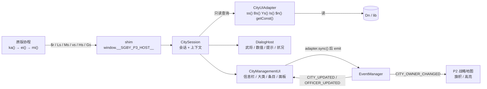

# P3 城市管理 UI 与武将选择系统 —— 运行与验证说明

> 阶段口径：**以现有网页版资源为准**（`original/site/sgby.min.js` 的运行行为 + `assets/game.zip` 的数据表）。
> 本阶段只做「城市管理界面 + 武将选择」，不含战斗地图、部队模型、战斗动画（P4/P5）。
> 原版 14 个文件（`sgby.min.js` / `game.zip` / `index.html` / `style.css` / `sw.js` / `config.json` / `local-bridge.js` / `server.mjs` / 使用说明 / build-info / start.bat）**一个字节未改**。

---

## 1. 一键运行

### 1.1 双击 `start.bat`（仓库根目录，新增）

```
D:\user_project\git\3d_games_explore\start.bat
```

行为：

| 情况 | 结果 |
|---|---|
| Node.js 缺失 | 提示安装路径 → `pause` → 退出码 1 |
| 端口 8787 已有服务 | 只打开浏览器 → `pause` → 退出码 0 |
| 端口空闲 | 延迟 2 秒拉起浏览器 + 前台启动 `original\server\server.mjs`；关窗即停服 |

纯 ASCII 编写（避免 cmd 代码页问题），**每条退出路径都有 `pause`**。

### 1.2 手动启动

```bash
cd original && node server/server.mjs
# 浏览器打开 http://127.0.0.1:8787/index3d.html
```

原版入口 `http://127.0.0.1:8787/` 不受影响（仍引用 `sgby.min.js`）。

### 1.3 进入城市管理的操作路径

1. 点顶部「原版画面」显示原版 2D 画面（主菜单尚未迁移，属 P6 范围）；
2. 在主菜单开新局（选剧本 → 确认），进入战略地图；
3. 关闭「原版画面」，在 3D 地图上**点击己方城市** → 城市信息栏 + 左侧大类 + 条目列表出现；
4. 点条目（如「内政·开垦」）→ 弹出独立武将窗口 → 选将 → 确认 → 原版结算并弹结果 → 数值真实变化。

### 1.4 测试命令

```bash
node --test tests/coordinate.test.mjs tests/adapter.test.mjs \
            tests/architecture.test.mjs tests/worldmap.test.mjs tests/p3.test.mjs
node tests/smoke.mjs            # 无头 Edge + CDP，含真实开局与真实鼠标点击
node tools/make_core.mjs        # 重新生成 sgby.core.js（幂等）
```

---

## 2. 本阶段真正的技术难点，以及解决方式

### 2.1 原版城市管理不是「函数 + 参数」，而是一段协程

```js
// L7426  ka()：玩家城市操作循环
for (;;) {
  const t = await zs(Dn.g_CityPos);                 // 选城（P2 已可用输入协议驱动）
  if (255 === t) return 1;
  if (城市不属于玩家) { await Ms(54 / 56); continue; }
  const e = await ei();                             // L4450 城市菜单
  255 !== e && (254 !== e ? await mi(t, e) : await Gs(t));
}

// L4450  ei()：4 大类 -> 二级菜单 -> 指令号
switch (await ni()) {                               // $r(..., getConst(37))  内政/外交/军备/状况
  case 0: return 1  + await ri();                   // $r(..., getConst(38))  14 项
  case 1: return 15 + await si();                   // $r(..., getConst(39))   5 项
  case 2: return 23 + await ii();                   // $r(..., getConst(40))   5 项
  case 3: return 254;                               // 状况 -> Gs()
}
```

`mi(city, action)`（L4609，760 行）内部才是规则：体力/金钱校验、`Ls()` 选将、
`Hs()` 取数值、随机数、写 `Dn`、`gs()` 压指令队列、`Zr()` 把武将移出城市队列……

**结论**：任何「自己写一遍开垦逻辑」的 UI 都会立刻违反「不复制业务规则」。
唯一可行的方向是——**让原版协程照原样跑，只把它的 6 个同步阻塞控件换成 HTML**。

### 2.2 为什么不能从外部覆写控件

`sgby.min.js` 是单文件 `type="module"`，顶层 `const`/`function` 全部处于**模块作用域**，
外部无法 `window.$r = ...`。因此 `tools/make_core.mjs` 在**生成副本**上做 7 处
「带完整签名的唯一字符串改名」，并在文件尾声明**同名 shim**（函数声明提升，早于任何调用生效）：

| 原函数 | 作用 | 改名后 | shim 语义 |
|---|---|---|---|
| `$r(rect,start,items)` | 通用列表菜单 | `$rOrig` | 返回条目下标 / 255 |
| `Ls(persons,count,x1..y2,start)` | 武将选择窗口 | `LsOrig` | 返回下标 / 255 |
| `Ms(constIdx)` | 单条提示 | `MsOrig` | void |
| `vs(personId,text)` | 带将提示 | `vsOrig` | void |
| `Hs(min,max,kind)` | 数值选择（粮/钱/兵） | `HsOrig` | 返回数值 / 65535 |
| `Gs(cityId)` | 城市状况报告 | `GsOrig` | 返回 1 确定 / 0 取消 |
| `ka()` | 玩家城市操作循环 | `kaOrig` | 划定接管窗口 |

生成器对每处改名做 `count === 1` 断言，缺一即拒绝生成；
**可逆还原后与 `sgby.min.js` 逐字节一致**（`tests/p3.test.mjs` 与 `tests/smoke.mjs` 双重校验）。

shim 的兜底策略：只有「**原版 ka() 正在跑 + 宿主实现了该方法**」才接管，
否则直接调用 `*Orig`（主菜单、回合菜单、战斗流程完全不受影响）。
接管抛错时**按该控件的「取消值」回卷**（255 / 65535 / 0），绝不回落到隐藏的 2D 画布
——否则会永久等待键盘而卡死。

### 2.3 状态同步链



* UI **不写** `Dn`，也不维护第二套权威数据；每次渲染都现读。
* 原版没有事件系统：`GameAdapter.sync()` 做快照 diff 后派发，UI 只订阅、只重画当前城市。
* 用户选择 → 交回原版协程 → 原版执行 → 再读真实数据，形成闭环。

---

## 3. 原版功能映射表（P3 §4.1）

菜单文本、顺序、消耗全部来自 `lib.getConst(37..40)` 与 `getItem(2,10|11)`，
UI 侧未硬编码任何名称。

| 原版功能（大类 / 条目） | 指令号 | 原版调用入口 | 新 UI 组件 | 状态 |
|---|---|---|---|---|
| 内政（14 项） | 0 | `ei()` case 0 → `ri()` → `$r(getConst(38))` | 左侧大类 `内政 14 项` + 中间条目列表 | ✅ |
| 开垦 / 招商 / 搜寻 / 治理 / 出巡 / 招降 / 处斩 / 流放 / 赏赐 / 没收 / 交易 / 宴请 | 1–12 | `mi()` `case 1..12` | 同上 + 武将窗口 + 结果提示 | ✅ 原版分支完整 |
| 输送 / 移动 | 13 / 14 | `mi()` `case Ke` / `case Ne`（常量 L2355） | 武将窗口 + `Hs()` 数值 + 地图选目标城 | ✅（目标城走 P2 选城协议） |
| 外交（5 项） | 1 | `ei()` case 1 → `si()` → `$r(getConst(39))` | 左侧大类 `外交 5 项` | ✅ |
| 离间 / 招揽 / 策反 / 劝降 | 15 / 16 / 17 / 19 | `mi()` `case qe/ze/He/Je` | 武将窗口 + 提示 | ✅ |
| **反间** | **18** | **`mi()` 无此分支（全文核对）** | 条目照原版显示（灰显 + tooltip） | ⚠️ 原版无实现，UI 选择后不产生任何效果（不伪造） |
| 军备（5 项） | 2 | `ei()` case 2 → `ii()` → `$r(getConst(40))` | 左侧大类 `军备 5 项` | ✅ |
| 侦察 / 征兵 / 分配 / 掠夺 / 出征 | 23 / 24 / 25 / 26 / 27 | `mi()` `case Ve/Ze/25/26/tn` | 武将窗口 + `Hs()` + 提示 | ✅（出征会进入战斗流程，属 P4/P5） |
| 状况 | 254 | `ei()` case 3 → `Gs()` | 左侧大类 `状况` + 右侧报告弹窗 | ✅ |
| 城市信息（归属/太守/农业/商业/民忠/防灾/人口/金钱/粮食/后备兵力/状态） | — | `Ys(cityId, 0..10)` | 顶部信息栏 + 概览两栏表 | ✅ 原文照搬，未二次加工 |
| 城市武将表 | — | `ss(cityId)` + `Bs(id, 0..12)` | 「武将」页签 + 武将弹窗表格 | ✅ 姓名 + 13 列 |
| 数值输入（粮食/金钱/士兵） | — | `Hs(min, max, 41/42/43)` | 数值弹窗（确定 / 最大 / 取消） | ✅ 与原版按钮语义一致 |

`mi()` 分支集合由 `tools/make_core.mjs` 在构建期扫描源码推导并写入 `core.p3.actionIds`：

```
1,2,3,4,5,6,7,8,9,10,11,12,13,14,15,16,17,19,23,24,25,26,27   （23 个，缺 18）
```

`tests/p3.test.mjs` 用独立实现的扫描器重新推导并比对，源码变更会立刻暴露。

---

## 4. 完成内容（对照 §十 交付物）

| # | 交付物 | 实现 | 证据 |
|---|---|---|---|
| 1 | 城市管理 UI 主界面 | `p3/CityManagementUI.mjs`：顶部信息栏 + 左侧大类 + 中间条目 + 右侧面板 + 页脚状态 | `sgby-p3-city-ui.png` |
| 2 | 城市信息栏 | 直接渲染 `Ys(cityId,0..10)` 的 11 行，按首个 `:` 切 label/value | smoke「信息栏 11 项」 |
| 3 | 左侧功能菜单 | 4 个大类按钮（`getConst(37)` 顺序），带条目数徽标 | smoke「左侧 4 大类」 |
| 4 | 右侧功能面板 | 页签：概览（两栏）/ 武将（14 列表格）/ 执行记录 | smoke「武将页签」「13 列」 |
| 5 | 原版城市功能映射 | 见 §3；条目名称、顺序、消耗全部取自原版数据 | `tests/p3.test.mjs` 逐项断言 |
| 6 | 原版功能调用适配 | 7 个控件 shim + `CitySession` 会话；调用链见 §2.3 | `sgby.core.js` 桥接段 |
| 7 | 武将列表 | 候选 = 原版 `ss()` 结果数组，原样交给 UI，不做二次筛选 | smoke「候选 2/2 人」 |
| 8 | 武将属性详情 | `Bs(id,0..12)` + 列标题 `getConst(24..36)`；当前行下方详情条 | `sgby-p3-officer-dialog.png` |
| 9 | 独立武将选择弹窗 | `p3/OfficerSelectDialog.mjs`：14 列表格、行高亮、双击/回车确认 | 同上 |
| 10 | 操作确认与结果提示 | `Ms()`→提示弹窗、`vs()`→带将提示、`Hs()`→数值弹窗、`Gs()`→状况弹窗 | smoke「原版指令结果以提示弹窗返回」 |
| 11 | 与 3D 地图联动 | 3D 点击 → `requestCitySelection(intent:'select')` → 原版 `zs()` 返回 → `ei()` | smoke「3D 点击己方城市」 |
| 12 | 城市状态实时同步 | `adapter.sync()` 事件 → 局部重画；执行前后用原版 `Ys()` 行做差异展示 | smoke「农业 1747→1789 / 金钱 202→152」 |
| 13 | 完整功能回归测试 | Node 58 + 页面自检 43 + 浏览器 59 | §6 |

---

## 5. 修改文件

### 5.1 原版文件

**零改动**。`git status` 对 `original/使用说明.txt`、`build-info.json`、`original/start.bat`、
`server/`、`site/index.html`、`site/style.css`、`site/sw.js`、`site/config.json`、
`site/local-bridge.js`、`site/sgby.min.js`、`site/assets/` 输出为空。

### 5.2 修改（已有文件）

| 文件 | 改动 |
|---|---|
| `tools/make_core.mjs` | 新增 7 处唯一字符串改名 + 模块级 shim + 桥接导出（`fns` 增 `ss/Bs/Ys/Is`，新增 `p3` 组含 `widgetNames/originals/cmdIds/costMoney/costThew/actionIds`）；构建期推导 `mi()` 分支集合并与基线比对 |
| `original/site/sgby.core.js` | 生成物（199,653B → 205,685B；7 处改名 + 5,961B 桥接） |
| `original/site/index3d.html` | 标题改 P3；引入 `p3/style.css`；工具栏新增 `#p3-chip` 城市会话状态 |
| `original/site/p1/main.mjs` | 装配 `createCityManager`；`MapInteraction` 增 `onCityClick` 回调；状态面板加 3 行 P3 指标；自检加 P3 套件；暴露 `window.__P3__` |
| `original/site/p2/MapInteraction.mjs` | 构造函数新增可选 `onCityClick`，命中城市后回调（只读通知，不改选中逻辑） |
| `tests/smoke.mjs` | core 一致性判据升级为「可逆还原后逐字节相同」；新增 P3 真机回归（点城 / 开垦 / 武将弹窗 / 反间 / 武将表 / 收起态 / 退出）+ 3 张截图 |
| `docs/P1-…md`、`docs/P2-…md` | 修正「`sgby.core.js` 前缀逐字节一致」的过期表述（P3 起有 7 处改名，可逆还原后一致） |

### 5.3 新增

| 文件 | 说明 |
|---|---|
| `original/site/p3/config.mjs` | UI 参数 + 原版常量/源码行号索引（不含规则） |
| `original/site/p3/CityUIAdapter.mjs` | 只读数据投影（`Ys/Bs/ss/Is/$n/getConst`），降级时如实标注 |
| `original/site/p3/CityManagementUI.mjs` | 主界面 DOM 与渲染 |
| `original/site/p3/Dialogs.mjs` | `DialogHost`（遮罩 / Esc / 统一收尾 / `cancelAll`） |
| `original/site/p3/OfficerSelectDialog.mjs` | 独立武将选择弹窗（`Ls` 等价物） |
| `original/site/p3/CitySession.mjs` | hook 宿主：6 个控件 → UI，`beginCityLoop/endCityLoop`，`zs` 等待时自动收起面板 |
| `original/site/p3/boot.mjs` | 装配 + `window.__P3__` |
| `original/site/p3/style.css` | 木质铜金风格；`#p3-city` 容器 `pointer-events:none`（收起态不吞点击） |
| `tests/p3.test.mjs` | 14 项 Node 一致性测试 |
| `start.bat` | 根目录一键启动（ASCII，全路径 `pause`） |
| `docs/P3-运行与验证说明.md` | 本文档 |

---

## 6. 新增接口

### 6.1 `window.__SGBY_CORE__.p3`（内核导出）

| 成员 | 说明 |
|---|---|
| `widgetNames` | `['$r','Ls','Ms','vs','Hs','Gs','ka']` |
| `originals` | 7 个 `*Orig` 引用（诊断/回退用；正常路径不调用） |
| `cmdIds` | `{ transport:13, move:14, sow:15, recruit:16, subvert:17, persuade:19, scout:23, conscript:24, attack:27 }` |
| `costMoney` / `costThew` | 原版 `Ge` / `Ye` 数组（按指令号索引） |
| `actionIds` | 构建期扫描出的 `mi()` 分支集合（23 个） |

`core.fns` 新增 `ss / Bs / Ys / Is`（原版只读查询函数，UI 直接调用，不复制其规则）。

### 6.2 `CitySession`（hook 宿主，契约见文件头）

`list / person / message / personMessage / value / report / beginCityLoop / endCityLoop / fail`，
统一返回 `{ handled, value }`：`handled=false` 时内核回落到 `*Orig`。

### 6.3 `CityUIAdapter`（只读）

`cityName / getCityReport / ownerName / playerKingId / currentCityId / getActionGroups /
hasBranch / messageText / valueLabel / officerName / getOfficerColumns / officerIds /
officerRow / getCityOfficers / officerRowsByIds`。

### 6.4 `CityManagementUI` / `DialogHost` / `OfficerSelectDialog`

`openCity / chooseEntry / pickEntry / close / requestExit / setCollapsed / setBusy /
setStatus / setHint / refresh / pushLog`；`DialogHost.open/cancelAll/dispose`；
`OfficerSelectDialog.ask({persons,startIndex,actionName,cityName}) → 下标|255`。

### 6.5 `window.__P3__`（调试/自动化）

`session / ui / cityUI / dialogHost / officerDialog / getStatus() / getSnapshot() /
getActionGroups() / runSmoke / switchScene`。

---

## 7. 测试结果

### 7.1 Node（真实 `game.zip` 数据 + 源码扫描）

```
node --test tests/coordinate.test.mjs tests/adapter.test.mjs \
            tests/architecture.test.mjs tests/worldmap.test.mjs tests/p3.test.mjs
→ 58 tests / 58 PASS / 0 FAIL
```

P3 新增 14 项：菜单 4 类 + 14/5/5、内政 14 项名称与 ID、外交/军备条目、消耗表抽查、
指令号常量（`Ke=13…tn=27`）、`mi()` 分支 23 个且缺 18、`hasBranch()` 只有 18 缺失、
`getConst` 下标、`splitFixedWidth`、38 城/200 将基线、`sgby.core.js` 可逆还原一致、
桥接 `actionIds` 字面量一致、`sgby.min.js` 未被改写、`CityUIAdapter` 降级契约。

### 7.2 页面内自检

`43 PASS / 0 FAIL`（P1 36 项 + P2 7 项 → 含 P3 新增 7 项：7 个接管点、4 类 14+5+5、
23 个分支缺 18、原版查询函数可用、未进会话时界面隐藏、对话框无残留、阻断标记只挂可见部件）。

### 7.3 浏览器真机（无头 Edge + CDP 真实鼠标事件）

```
node tests/smoke.mjs
→ 浏览器 smoke：59 PASS / 0 FAIL
```

关键实测（本次运行原始数据）：

| 项 | 实测 |
|---|---|
| 真实开局 | 3 次确认键 → `year=190`，`kind=zs` |
| 3D 点击己方城 | 目标屏幕点 `elementFromPoint` = `CANVAS` → 打开城 #0「西凉」 |
| 信息栏 | 11 项，城市名 `西凉` 与原版一致 |
| 菜单 | 大类 4 / 内政条目 14；外交切换后 5 项 |
| 开垦 | 弹武将窗（候选 2/2 人、14 列）→ 选韩遂 → 结果提示 → **农业 1747→1789、金钱 202→152** |
| 指令后 | 原版回到 `zs()`，面板自动收起让出地图；再点城市可重新进菜单 |
| 武将表 | 1 行 × 14 列（= 当前 `ss()` 人数）；指令后由 2 人变 1 人（原版 `Zr()` 移出队列） |
| 反间（18） | 不弹窗、金钱/农业均未变 —— 原版无分支，UI 不伪造 |
| 遮挡点击 | 面板展开时 3D 点击计数 2→2（不穿透） |
| 退出 | 界面关闭 → 原版回到 `zs()`，`canSelect=true` |
| 异常 | `exceptions=0`；唯一 console error 是测试关闭 SW 后的 `/sw.js` 404（P2 已确认无害） |
| 渲染 | `drawCalls=88`，无新增 rAF 循环 |

截图（`%TEMP%`）：

* `sgby-p3-city-ui.png` —— 展开态城市管理界面（信息栏 11 字段 / 概览两栏 / 条目含体力·金钱消耗）
* `sgby-p3-officer-dialog.png` —— 独立武将弹窗（姓名+13 列 / 当前行高亮 / 详情条 / 确认·取消）
* `sgby-p3-city-collapsed.png` —— 指令结束后的收起条（地图完全可点）

---

## 8. 验收对照

### 8.1 §十一 P3 完成效果

| # | 要求 | 结果 |
|---|---|---|
| 1 | 启动游戏并进入 3D 战略地图 | ✅ P2 能力保持，P3 未改动启动链 |
| 2 | 点击玩家控制的城市 | ✅ 实测 #0 西凉 |
| 3 | 进入城市管理界面 | ✅ 原版 `ei()` 驱动，界面由 `$r` shim 打开 |
| 4 | 左侧选择原版城市功能 | ✅ 4 大类 + 14/5/5 条目，顺序与名称取自原版 |
| 5 | 右侧完成对应操作 | ✅ 武将窗 / 数值窗 / 提示窗 / 状况窗 |
| 6 | 打开独立武将选择弹窗 | ✅ 宽面板 + 14 列表格 + 详情条 |
| 7 | 查看属性并完成选择 | ✅ 属性来自 `Bs()`，双击/回车/确认均可 |
| 8 | 执行原版城市管理操作 | ✅ 由 `mi()` 执行，UI 零规则 |
| 9 | 看到真实数据变化 | ✅ 农业/金钱变化与 `Ys()` 行差异同时展示 |
| 10 | 退出并返回 3D 战略地图 | ✅ `ei()` 返回 255 → 回到 `zs()` |

### 8.2 §九 测试要求

| 测试 | 结果 |
|---|---|
| 1 城市进入和退出 | ✅ 打开显示正确城名与 11 项资源；退出回地图 |
| 2 城市信息 | ✅ 与 `Ys()` 完全同源；数值变化实时刷新；归属变化走 `CITY_OWNER_CHANGED` |
| 3 功能菜单 | ✅ 数量 4/14/5/5、顺序、名称、消耗、可用条件（由原版 `mi()` 判定）一致 |
| 4 武将选择 | ✅ 列表 = `ss()`；属性 = `Bs()`；禁用条件不在 UI（原版 `Ms(Hr)` 提示）；取消不改数据 |
| 5 功能执行 | ✅ 开垦全链路实测；执行链路对全部 23 个有分支指令同构（同一 `Ls/Ms/vs/Hs` 装配） |
| 6 UI 交互 | ✅ 弹窗不穿透、页签切换、滚动、关闭、退出、窗口缩放（P1 resize 链路保持） |

### 8.3 §十四 交付物 / §十六 约束

* 交付物 13 项：见 §4（全部有实测证据）。
* 约束：只做本阶段；未提前实现战斗；以真实源码为依据（无一处猜测接口）；
  未修改无关原版逻辑（14 文件零改动）；无模拟数据；无 TODO/空函数；
  `start.bat` 与测试均可运行；发现的原版行为差异（§9）已如实记录、未擅自更改。

---

## 9. 遗留问题（未擅自改规则）

1. **指令 18「反间」在原版 `mi()` 中无分支**（L4609–5368 全文核对，构建期再次扫描确认）。
   UI 照原版菜单显示该条目（灰显 + tooltip 说明），选择后不产生任何效果。
   这是原版网页版的行为，P3 不补齐、不伪造。
2. **原版 `ka()` 每条指令执行后必然回到 `zs()`**（源码决定）。因此城市面板在指令结束时会
   自动收起成提示条并让出地图，需要再点城市才能继续下一条指令 —— 这不是 UI 缺陷，
   而是原版操作流。P3 已用提示文案说明；是否要「合并为连续菜单」属于产品决策，需你拍板。
3. **没有「结束城市操作」的 HTML 出口**：原版是 `zs()` 返回 255（Esc/返回键）结束 `ka()`。
   该键目前只能通过原版 2D 画面触发。回合推进 `Ma()`/`wa()` 属 P6 范围。
4. **执行指令后武将离开城市队列**（原版 `Zr()` L3253 从 `PersonQueue` 移除）。
   UI 如实反映（武将表人数减少），未做任何「补偿」。
5. **道具列（道具一/二）为空**：`Bs()` 读取 `g_Persons[].Equip`，本剧本该将为空。
   UI 显示原版的空字符串，不填占位符。
6. **弹窗内不支持键盘方向键选择列表**：`$r`/`Ls` 的键盘导航尚未映射到 HTML
   （鼠标与回车/双击可用）。触摸屏同理未适配。
7. **战斗相关指令（出征 27）只走原版流程**：会进入原版战斗，3D 战斗地图属 P4/P5。
8. **主菜单 / 剧本选择 / 回合菜单仍是原版 2D**：需点「原版画面」操作，属 P6。
9. `_resolveEntry` 在会话异常结束（`endCityLoop`）时由 `ui.close()` 统一回卷；
   若未来出现「会话结束但 Promise 仍挂着」的路径，需补超时兜底（当前未观察到）。
10. `.glb` MIME 与 SW 白名单仍未补（P2 遗留）；P3 未引入任何模型资源。

---

## 10. P4 前置条件

1. **确认 P3 验收**（尤其 §9-2 的「每轮回 zs」是否符合你的产品预期）。
2. 决定出征（27）进入战斗时，3D 场景如何接管原版 `Uo()` 战斗协程
   （复用 P3 已验证的「控件接管」模式，还是另设战场驱动器）。
3. 明确战斗的 6 个交互控件（`g_FgtParam` 相关菜单）与 3D 战棋点击的边界。
4. 确认战斗地图资源：`struct/战斗地图1..7.json` 为 32×32 逻辑格，
   贴图是否使用原版 `pics/` 中的战斗图块（需先盘点资源 id）。
5. 约定战斗中的输入阻断策略（P3 的 `input.setUIOpen` 已在弹窗期验证可用）。
