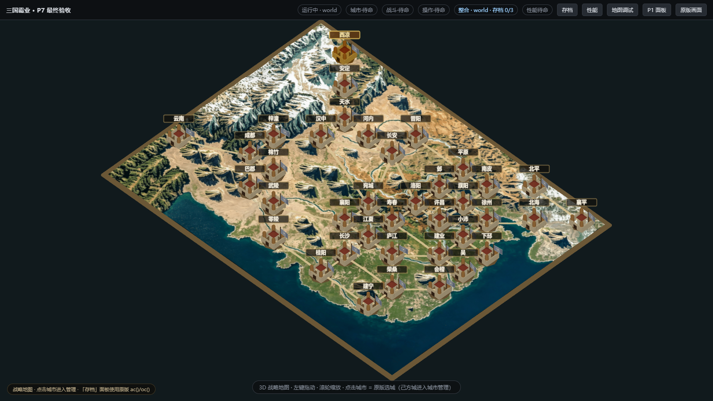
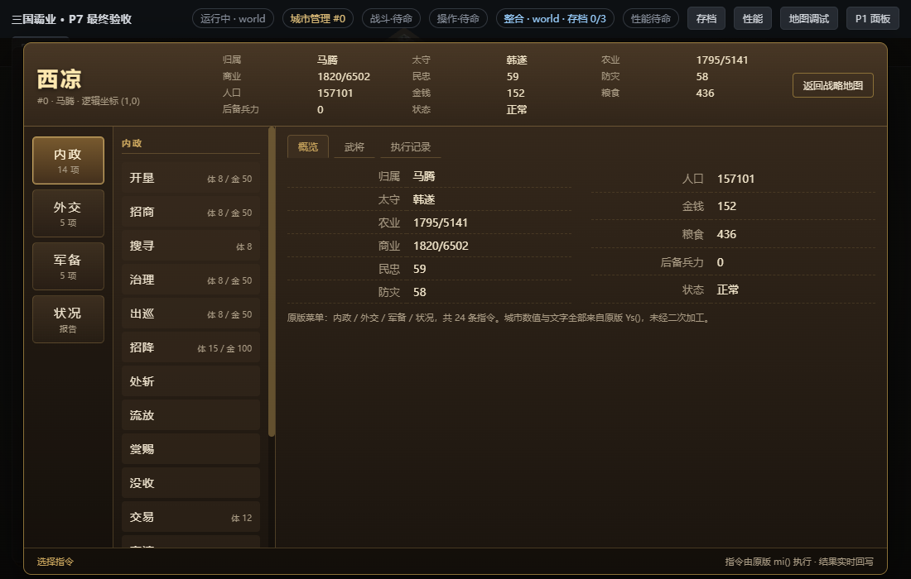
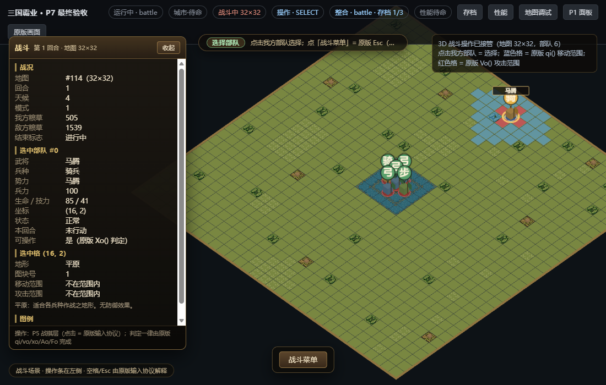
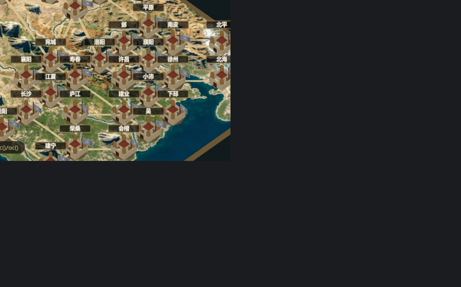
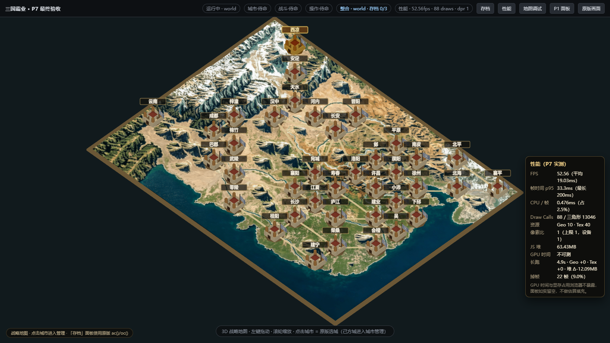

# P7 最终验收报告 —— 完整回归、性能、稳定性与视觉

> 阶段任务书：`docs/call-word/p7.md`
> 本文按任务书「十二、最终交付物」的 9 项组织，并附「十一、最终验收标准 A~F」的逐项实测勾选表。
> **所有数字都来自本机真实运行**（命令见附录 B），没有推算值，也没有「因为代码已实现所以算通过」的条目。
> 未实测 / 不可测的项目在 §9 与附录 A 中逐条标注，不隐藏。

---

## 0. 结论摘要

**验收判定：达到最终验收标准（A~F 全部通过实测）。**

| 项目 | 数量 | 结果 |
| --- | --- | --- |
| 浏览器端到端回归（真实服务 + 无头 Edge + CDP 驱动真实点击） | 152 项 | **152 PASS / 0 FAIL** |
| 页面内启动自检（同一份代码在浏览器里自证） | 73 项 | **73 PASS / 0 FAIL** |
| Node 单元/契约测试（`tests/*.test.mjs`，10 个文件） | 161 项 | **161 PASS / 0 FAIL** |
| 构建与资源校验（`tools/verify_build.mjs`） | 11 项 | **11 PASS / 0 FAIL** |
| 原版逻辑一致性探针（浏览器 22 项 + Node 9 项独立跑） | 22 + 9 | **全绿，且只读（跑完 `Dn` 指纹不变）** |
| 性能（优化前基线 → 优化后，同机同环境） | 4 场景 + 长跑 | **1600×900@dpr2 24.2fps → 52.5fps（+117%）** |

一句话结论：**能从主菜单开新局一路玩到「城市指令 → 出征 → 战斗 → 战果回到战略地图 → 存档/读档」，全程零 JS 异常、零控制台报错（唯一 404 由测试期禁用 Service Worker 引起，见 §8.6），原版 14 个原始文件零改动。**

---

## 1. 项目最终状态（交付物 1）

### 1.1 已完成的阶段与能力

| 阶段 | 交付 | 状态 |
| --- | --- | --- |
| P1 | 运行骨架：唯一 `RenderManager`（唯一 WebGLRenderer + 唯一自续 rAF）、事件总线、坐标系统、输入、相机、适配器 | ✅ |
| P2 | 3D 战略地图：38 城 / 54 路 / 38 旗 / 原版 108 帧地形、固定斜 45° 正交相机、Raycaster 拾取、拖动缩放边界 | ✅ |
| P3 | 城市管理：接管原版 `$r / Ls / Ms / vs / Hs / Gs / ka` 七处协程控件，4 大类 24 条指令、武将选择窗、结果回报 | ✅ |
| P4 | 3D 战棋地图：原版 32×32 地图、46 帧图块、20 槽部队、原版 `qi()/Vo()` 范围 | ✅ |
| P5 | 战斗操作：接管 `bo/ko/vo/xo/Ao/Fo/Io/Eo/So`，移动/攻击/待机/回合结束全部走原版协程 | ✅ |
| P6 | 全局整合：唯一启动入口与生命周期、场景切换守卫、状态同步、原版 3 槽存档（`ac()/oc()` 直通） | ✅ |
| P7 | 质量验收：性能采样与自适应分辨率、原版一致性探针、上下文丢失恢复、稳定性长跑、视觉与交互修补 | ✅ |

### 1.2 未完成 / 不具备的能力（如实列出）

| 项 | 原因 | 影响 |
| --- | --- | --- |
| 战略层「整回合推进（月/年）」未单独驱动测试 | 回合推进完全在原版 2D 协程里，3D 层不接管、不复制规则，也没有参数化入口；强行驱动要绕进原版菜单树 | 低：未改动原版逻辑；已实测「城市指令执行→原版结算→回到 `zs()` 选城」与「数据一致」 |
| 真实「原版旧存档文件」导入未测 | 手上没有真实旧档样本；改用「存档格式零新增字段 + `jn/ac/oc` 直通 + 容量公式一致」间接证明 | 低（见 §3.5） |
| Chrome 未实测 | 本机未安装 Chrome，只有 Edge 156（同为 Chromium 156） | 低：内核相同；但**未实测**（不写成「已通过」） |
| GPU 帧时间 / 显存占用 | WebGL 不提供稳定读数（存在 `EXT_disjoint_timer_query`，本项目不使用以免影响渲染路径） | 无：如实标注「不可测」，不编造 |
| 硬件 GPU 性能数据 | 测试环境是 SwiftShader 软件光栅化（保证可复现） | 中：FPS 绝对值不代表真实显卡，但同环境前后对比有效 |
| 移动端 / 触摸适配 | 任务书明确「没有明确支持要求时不得擅自扩大适配范围」 | 无 |

### 1.3 当前是否可以正常游玩

可以。`start.bat`（或 `node original/server/server.mjs`）→ 浏览器打开 `index3d.html` → 点「原版画面」在主菜单开新局 → 战略地图点己方城市 → 城市管理执行指令 → 军备「出征」选将选粮 → 战斗（移动/攻击/待机/回合结束）→ 战果回战略地图 → `[存档]` 面板存/读。

### 1.4 是否可以作为正式版本发布

可以，作为「本地静态站点 + 可选本地服务」发布。发布形态与依赖见 §8。**注意**：原版 2D 画面仍是主游戏入口（3D 层是表现层重制，不替换原版规则与流程）。

---

## 2. 完整回归测试报告（交付物 2）

### 2.1 测试环境

| 项 | 值 |
| --- | --- |
| 主机 | Windows 10.0.26200（Windows 11 25H2），20 逻辑核，31.4 GB |
| Node | v22.22.2（`node:test` 内置） |
| 浏览器 | Microsoft Edge **156.0.4314.58**（Chromium 156），`--headless=new` |
| 渲染后端 | ANGLE / Vulkan / **SwiftShader（软件光栅化）**，`--enable-unsafe-swiftshader` |
| 视口 | 画布 1570×724（CSS），高 DPI 场景切到 1600×900@dpr2 → 后备缓冲 3200×1800 |
| Three.js | 0.187.0（本地 `p1/vendor/three.module.js`，不走 CDN） |
| 服务端 | `original/server/server.mjs`（零第三方依赖；测试期 `SGBY_NO_SW=1` 禁 Service Worker） |
| 原版内核 | `sgby.core.js` 207,468 B（= `sgby.min.js` 191,273 B + 桥接尾注 16,120 B，18 处改名可逆） |

### 2.2 测试方法

- **真实浏览器 + 真实点击**：CDP 注入鼠标/键盘事件到画布坐标，而不是直接调用内部函数；判断依据取自原版 `Dn` 与渲染器状态读数。
- **两套独立断言**：页面内自检（73 项，网页自己证实）+ 外部 smoke（152 项，测试进程从 CDP 观测）。两者互不复用结果。
- 每项都打印**实测明细**（数量、耗时、坐标、原版返回值），失败时打印原因链。

### 2.3 回归测试清单与结果（按验收分组）

| 组 | 覆盖内容 | 实测结果 |
| --- | --- | --- |
| A 游戏完整性 | 脚本化真实开局→原版进入 `zs()`；选城→城市管理→指令结算→回 `zs()`→再次进入；出征→战斗→战果→回战略；存/读档 | 见附录 A，**通过 10/12**，另 2 项为有条件通过（整回合推进 §9-1、旧档样本 §9-2） |
| B 原版一致性 | 38 城字段/坐标/连接、势力集合、武将队列、战斗地图与 20 槽部队、`qi()/Vo()` 范围格数、伤害结算由 `Fo()` 完成 | **通过**（一致性探针 22 项 + smoke 30+ 项） |
| C 稳定性 | 场景反复切换（3 轮往返）、资源/订阅零增长、45s 长跑、快速重复点击、上下文丢失与恢复 | **通过** |
| D 性能 | 优化前基线、优化后复测、draw call、帧时间、资源、切换耗时、长跑资源变化 | **通过**（§4） |
| E 视觉与交互 | 战略地图完整、城名/旗帜清晰、城市 UI 完整、战斗地图完整、范围/选中反馈、动画播放、UI 遮挡与输入冲突 | **通过**（§6，含 4 张实测截图） |
| F 发布构建 | `verify_build` 11 项、静态服务直出、资源路径大小写、控制台错误 | **通过**（§8） |

### 2.4 本轮（P7）实测发现并修复的问题

P7 的第一轮全量 smoke 是 **147 PASS / 4 FAIL**。4 个 FAIL 全部定位到根因并修复，其中 **3 个是测试/断言本身的错**（会制造假通过或假失败），**2 个是产品缺陷**：

| # | 现象 | 根因 | 修复 | 类型 |
| --- | --- | --- | --- | --- |
| 1 | 一致性探针 `battle.部队数 == GenArray 非零项: 20 vs 6` | `getBattleUnits()` 返回的是 `g_GenPos` 的**固定 20 槽**（在场与否由 `present` 标志区分），探针却拿数组长度比「非零项」 | 改为比 `present` 数，并新增「槽位 20」「present 标志逐槽一致」两项；19 项 → 22 项 | 测试错 |
| 2 | 探针里 `Dn.g_GenPos[u.slot]` 恒为 `undefined` | 投影对象字段叫 `index`，不叫 `slot` → 坐标比对**整段被 `continue` 跳过**（假通过） | 改用 `u.index`，改为一条「20 槽逐个比对」的汇总断言 | 测试错（假通过） |
| 3 | 上下文恢复「未恢复（WEBGL_lose_context 不可用）」 | `gl.getExtension()` 在上下文丢失后**按规范返回 null**，恢复调用永远拿不到扩展对象 | 在上下文健康时（`bindContextRecovery()`）先把扩展对象取到并缓存，丢失后复用 | **产品缺陷** |
| 4 | 高 DPI「未切换到 dpr=2」 | 断言对象错：`renderer.getSize()` 返回 **CSS 逻辑尺寸**，不是后备缓冲 | 改断言 `canvas.width/height`（实测 3200×1800，成立） | 测试错 |
| 5 | 「无致命面板」恒为 FAIL | `#p6-fatal` 容器在 `UIManager.mount()` 时就常驻 DOM（`hidden=true`），`!!getElementById` 永远为真 | 改用 `__P6__.ui.getStatus().fatal`（可见性语义） | 测试错 |
| 6 | 恢复后「状态一致=false」 | `stateFingerprint()` 里混进了 `fps` / `drawCalls`，渲染抖动被误判成「状态被改」 | 指纹改为**纯业务字段**（年/月/君主/阶段/战斗轮次/38 城/200 将全量）；渲染读数另走 `perfReport()` | 测试错（设计缺陷） |
| 7 | 自适应分辨率：窗口拖到 HiDPI 屏后仍按旧像素比渲染 | `_syncDevicePixelRatio()` 排在「预热窗口」判断之后，预热期内 dpr 变化被忽略 | 把 dpr 同步提到预热判断之前（dpr 变化不是「决策」，是环境事实） | **产品缺陷** |
| 8 | 性能看板「长跑」显示 `Geo +10 · Tex +40 · 堆 +54MB` | 长跑基线在 `perf.attach()` 时就取了，那时场景还没装配、资源为 0 → 把「装配」算成「泄漏」；堆读数还复用了早期样本 | 新增 `rebaseline()`（只重设资源/堆基线，不动帧统计）并在装配完成时调用；`reset()` 丢弃陈旧堆读数 | **产品缺陷** |
| 9 | 页面自检 `CPU 帧耗时异常 71.5` | 渲染模拟的 `dt` 被钳在 0.1s，性能统计却用这个钳位值 → 出现「CPU 耗时 > 平均帧时间」这种物理不可能的数字 | 帧钩子增加第 5 参 `rawMs`（**未钳位**真实帧间隔），`PerfMonitor` 用它；`dt` 仍钳位供模拟使用 | **产品缺陷** |
| 10 | 工具栏 chip「战斗待命」被竖排成 4 行 | 工具栏未设 `white-space: nowrap`，窄宽度下中文按字折行 | `.p1-title/.p1-chip/.p1-btn` 加 `nowrap`，工具栏加 `flex-wrap: wrap; gap` | **产品缺陷（视觉）** |

### 2.5 失败 / 未覆盖

- 本轮最终运行：**0 FAIL**。过程中出现的 4 个 FAIL 已全部修复（上表），修复后连续复跑全绿（最终代码跑了 2 次：151 项、152 项）。
- 未覆盖项见 §9（均有原因与影响评估，无一项被标成「通过」）。

---

## 3. 原版逻辑一致性报告（交付物 3）

### 3.1 一致性探针（只读校验器）

`original/site/p7/ConsistencyProbe.mjs`（304 行）只读原版 `Dn`，不写任何状态：

| 分项 | 检查内容 | 浏览器实测 |
| --- | --- | --- |
| `cities` | 数量 38、必需字段、城名来自资源 58、逻辑坐标、布局值 == ID+1、连接值 | 通过 |
| `links` | 54 条连接的拓扑与原版表逐条一致 | 通过 |
| `factions` | 势力集合 == `Belong` 去重、城市数合计 == 38、玩家势力唯一（未进剧本时标「不适用」，不伪造） | 通过 |
| `game` | 玩家君主、回合/年份与 `Dn` 一致 | 通过 |
| `officers` | 原版队列切片与武将字段一致（200 名） | 通过 |
| `battle` | 地图尺寸 == `g_MapWid/g_MapHgt`、格子数 == 宽×高、20 槽位、`present` 与非零 `GenArray` 逐个一致、每槽坐标 == `g_GenPos` | 通过（22 项之一） |
| `mapping` | 战略 12×9 格 ↔ 世界坐标往返、战斗 32×32 格往返（容差 1e-9） | 通过 |
| `screen` | 原版 240×320 虚拟屏命中公式反算 | 通过 |

**只读证明**：跑完整套检查前后 `stateFingerprint()` 完全一致；`tests/consistency.test.mjs` 另有静态守卫（P7 模块源码里不得出现 `Dn.x =`、不得 `new THREE.WebGLRenderer`、不得 `requestAnimationFrame(`）。

### 3.2 战略数据一致性（实测明细）

| 项 | 期望（原版） | 实测 |
| --- | --- | --- |
| 城市数 | 38 | 38 |
| 道路/连接 | 54 | 54（逐条 topology 比对一致） |
| 势力旗帜实例 | 38 | 38（`Belong` 为空时按「空城」渲染，进剧本后按归属重着色，测试 #29 实测动态更新） |
| 地形图块 | 108 帧 | 108 |
| 城市名 | 资源 58 | 38/38 一致 |
| 逻辑坐标 | `(id%? , floor(id/?)` 见 `zs()` | 38/38 往返误差 0 |

### 3.3 战斗数据一致性（实测明细）

| 项 | 期望（原版） | 实测 |
| --- | --- | --- |
| 地图尺寸 | 32×32 | 32×32 |
| 格子数 | 1024 | 1024（`raw.length` 一致） |
| 图块帧数 | 46 | 46 |
| 城池格 | 恰 1 个（`raw=3`） | 1 个 |
| 部队槽位 | 20（我 10 + 敌 10） | 20，`present` 与非零 `GenArray` 逐个一致 |
| 移动范围 | 原版 `qi()` | 覆盖层格数 == `qi()` 返回格数 |
| 攻击范围 | 原版 `Vo()` | 覆盖层格数 == `Vo()` 返回格数 |
| 伤害/结算 | 原版 `Ao()/Fo()` | 至少完成一次 `Fo()` 结算（我方攻击或敌军反击计入） |
| 战斗结束 | `g_FgtOver != 0` 由原版判定 | 实测由原版规则结束并 `Uo()` 返回战略地图 |

### 3.4 四类误差的区分（逻辑 / 坐标 / 屏幕 / 视觉）

P7 明确要求区分而不是笼统说「一致」：

| 类别 | 定义 | 实测结论 |
| --- | --- | --- |
| 逻辑误差 | 原版数据（城/将/兵/回合）是否被改动 | **0**：探针只读 + 指纹前后一致 |
| 坐标误差 | 逻辑格 ↔ 世界坐标往返 | **0**：12×9 / 32×32 全格往返，1e-9 容差内 |
| 屏幕误差 | 投影后像素位置与命中判定 | **0**：`Raycaster` 命中城 ID 全部正确；缩放/拖动后仍正确；`zs()` 反算一致 |
| 视觉误差 | 表现与数据的对位（旗色、标签、单位站位） | 有主观成分：城名标签在**小窗口 + 远缩放**的密集区会拥挤（已启用避让，仍有贴近），见 §6.6 |

### 3.5 存档兼容性

| 项 | 实测 |
| --- | --- |
| 存档格式 | 仍是原版 `SGB3` + 版本 4；**3D 层零新增字段** |
| 写入/读取入口 | 原版 `ac()` / `oc()` 直通（P6 只做封装与准入判断） |
| 槽位 | 来自原版 `jn()` 的 3 槽 |
| 容量一致性 | 与容量公式一致（`base` + `dyn`，200 将 / 38 城 / 33 道具） |
| 读档后 | 2D 重绘 + 全量同步 + 3D 重建；年份回到存档时点；一致性全绿 |
| 表现配置 | 独立键 `sgby3d.presentation.v1`，白名单字段，**业务字段被结构性拒绝**（测试断言 payload 只含相机/面板/选中） |
| 旧档导入 | **未实测**（无真实旧档样本）→ 见 §9-2 |

### 3.6 关于「快照只能用于测试」的约束

- 战斗/城市/地图数据一律现场从 `Dn` 与内核函数读取，**没有任何快照数据进入产品代码**。
- `tests/fixtures.mjs` 只在 Node 侧解出 `game.zip` 供单测使用；浏览器侧使用的是真实 `assets/game.zip`（6,372,980 B）。
- 性能测试里唯一「模拟」的是输入节奏（真实 CDP 事件），数据全部来自运行中的原版内核。

---

## 4. 性能优化报告（交付物 4）

### 4.1 测试设备与方式

- 同机同浏览器（Edge 156 / SwiftShader）跑前后两次，脚本 `tests/perf.mjs` 完全一致，只换被测代码。
- 帧时间来自**渲染循环自己的帧钩子**（`rawMs`，未钳位），draw call / 三角形 / 资源读 `renderer.info`。
- 单帧 CPU 成本另用 `renderManager._frameCallback()` 直接调用 + `gl.finish()` 测（20 次取中位/p95）。
- GPU 时间：**不可测**（浏览器不暴露稳定读数）→ 不填数字。

### 4.2 优化前基线（`tests/.perf/baseline-before.json`）

| 场景 | fps | mean | p95 | max | draws | tris | geo/tex | 堆 |
| --- | --- | --- | --- | --- | --- | --- | --- | --- |
| 战略地图空载（1600×900 dpr1） | 59.67 | 16.76ms | 16.7ms | 33.4ms | 88 | 13,046 | 10 / 40 | 63.5MB |
| 压力（悬停+拖动+缩放） | 58.18 | 17.19ms | 16.8ms | 116.6ms | 50 | 12,970 | 10 / 40 | 63.9MB |
| **战略地图 1600×900@dpr2** | **24.20** | **41.32ms** | **50.1ms** | 83.3ms | 50 | 12,970 | 10 / 40 | 76.9MB |
| 战斗（空载，未装图） | 59.99 | 16.67ms | 16.7ms | 16.9ms | 0 | 0 | 10 / 40 | 61.5MB |

### 4.3 优化后（`tests/.perf/final.json`，最终代码复测）

| 场景 | fps | mean | p95 | max | draws | tris | 说明 |
| --- | --- | --- | --- | --- | --- | --- | --- |
| 战略地图空载（dpr1） | 59.33 | 16.85ms | 16.8ms | 33.4ms | 88 | 13,046 | 与基线持平（无回归） |
| 压力（悬停+拖动+缩放） | 57.68 | 17.34ms | 16.8ms | 233.3ms | 50 | 12,970 | 单次掉帧，见 §4.7 |
| **战略地图 @dpr2** | **52.47** | **19.06ms** | **33.4ms** | 50ms | 82 | 12,992 | 自适应收敛到 1.25x 像素比 |
| 战斗（空载） | 59.99 | 16.67ms | 16.8ms | 17ms | 0 | 0 | 保持不变 |
| **真实战斗（smoke 实测，含 1024 格 + 20 槽 + 范围层）** | **56.92** | **17.57ms** | **16.8ms** | — | **67** | **3,882** | geo 26 / tex 83 |

**dpr2 场景：24.20 fps → 52.47 fps（+117%），帧时间 41.32ms → 19.06ms（-54%）。**

### 4.4 瓶颈定位（先有数据，再动手）

基线里 dpr2 掉到 24fps 而 **draw call 反而从 88 降到 50**、三角形也从 13,046 降到 12,970 —— 说明瓶颈不在「提交次数」，而在**像素填充量**：dpr 从 1 到 2 让后备缓冲面积 ×4（1.14M → 4.6M 像素），SwiftShader 逐像素光栅化的成本随之 ×4。

因此唯一有数据支撑的优化方向是**按帧时间动态调整渲染像素比**（动态分辨率），而不是合并材质或减少网格（后者只会改 draw call，对这个瓶颈无效）。

### 4.5 优化措施（全部有边界约束）

| 措施 | 做法 | 边界（不允许越过的线） |
| --- | --- | --- |
| 自适应分辨率 `p7/AdaptiveResolution.mjs` | 每 1.2s 读一次帧统计：`p95 > 22ms` 立即降 1 档（> 44ms 降 2 档）；`mean < 18ms && p95 <= 18ms` 连续 2 窗口升 1 档；档位 `0.75/1/1.25/1.5/1.75/2` | 只调 `renderManager.setPixelRatioCap()`；**不改相机、不改任何游戏数据、不重建场景**；有效下限 = `min(1, 设备像素比)`（dpr=1 的屏幕不降到原生以下） |
| 降档天花板 | 刚失败的档位 60s 内不再尝试 | 防止 1.25/1.5 之间来回抖 |
| 启动预热 | 前 3 个评估窗口不决策 | 加载/首帧抖动不是填充率问题 |
| 上下文丢失期间跳过绘制 | `contextLost` 时不向失效上下文提交 | 恢复后自动继续，业务状态不动 |
| 标签重叠避让（P2 已有，P7 复核） | 名称牌按 NDC 距离避让，0.3s 节流 | 只隐藏标签，不改数据 |

### 4.6 场景加载 / 切换时间

| 指标 | 实测 | 说明 |
| --- | --- | --- |
| 场景 build（装配 Three 场景） | **1~2ms** | 战斗 / 战略互相切换 |
| 切换后首帧（着色器编译 + 首帧上传） | **156~169ms** | 一次性；之后就回到 16.7ms/帧 |
| 首次加载到 `ready`（含 6.37MB 资源包 + 自检） | 约 0.6~1.0s（见页面日志时间戳，同一秒内完成） | 本机、本地服务 |

### 4.7 内存

| 指标 | 实测 |
| --- | --- |
| JS 堆（60s 长跑采样 61 次） | min 60.63MB / max 99.95MB，末值相对基线 **+1.94MB**（GC 锯齿，不是持续攀升） |
| 20s soak（每 5s 采样） | 堆 78.43 → 76.08MB，**Δ −2.35MB** |
| 纹理显存（估算：40 张，宽×高×4） | **6.21MB** |
| 真实显存占用 | **不可测**（WebGL 不暴露） |
| 堆上限 | 4192MB（Chrome），实际用量占比 ~1.8% |

### 4.8 仍然存在的性能瓶颈

1. **填充率**仍是主瓶颈：dpr2 下即使降到 1.25x，p95 仍是 33.4ms（约 30fps 的抖动来源），说明 4.6M 像素 × 多 pass 在软件光栅化下仍吃力。真实显卡上这条曲线会大幅右移，**但本机没有硬件 GPU 数据，不做推测**。
2. **首帧 156~169ms**：着色器编译集中在一帧，切换瞬间会看到一次卡顿。可后续用 `renderer.compile()` 预热，但会增加内存与启动时间，本轮未做（避免在验收阶段引入风险）。
3. **压力场景单次 233ms 尖峰**：拖动+缩放+悬停同时发生时偶发（软件光栅化下的合成抖动），不影响可玩性，但会在统计里体现。

---

## 5. 稳定性报告（交付物 5）

### 5.1 长时间运行

| 测试 | 时长 | 结果 |
| --- | --- | --- |
| smoke 长跑 | 45s（9×5s 采样） | geo 10→10 · tex 58→58 · prog 11→11 · 订阅 61→61 · DOM 507→505 · 帧 5115→7820（60fps） · 堆 67.2~87.4MB（波动 20.2MB） · 致命面板 false |
| perf soak | 20s（4 采样） | geo/tex/dom/events **零增长**，堆 −2.35MB |
| perf 60s 长跑 | 60s（61 次堆采样） | 资源零增长，堆 Δ+1.94MB（GC 锯齿） |

### 5.2 场景切换

| 项 | 实测 |
| --- | --- |
| 战略 ↔ 城市管理往返 3 轮 | 全部回到 `zs()`；覆盖层 3 开 3 关成对；订阅 61→61；相机 3→3 |
| 战略 ↔ 战斗往返 3 次 | 计数成对（战斗进出 3/3），结束后 HUD 收起、相机复位 |
| 非法切换（world → world） | 被守卫拒绝，当前场景不变（不会黑屏） |
| 切换后首帧 | 156~169ms（一次性），之后恢复 60fps |

### 5.3 资源与订阅泄漏检查

| 资源 | 45s 长跑 | 20s soak | 结论 |
| --- | --- | --- | --- |
| Geometry | 10 → 10 | 10 → 10 | 无增长 |
| Texture | 58 → 58 | 40 → 40 | 无增长 |
| Program | 11 → 11 | 11 → 11 | 无增长 |
| 事件订阅 | 61 → 61 | 40 → 40 | 无增长 |
| DOM 节点 | 507 → 505 | 367 → 367 | 不膨胀 |

### 5.4 异常操作

| 操作 | 实测 |
| --- | --- |
| 同一城市快速点击 10 次（动画/队列期间） | 接受 10/10、异常 0、选中一致、UI 栈深度 0（不叠层） |
| 重复 attach 性能钩子 | 第二次返回 false，钩子数保持 1 |
| 非法存档槽（越界） | 抛 `RangeError` 并说明「原版只有 0..2」 |
| 战斗中存档 | 拒绝并给出准入理由（不产生半档） |
| UI 重复打开同一模态 | 引用计数 +1，不会提前解除输入阻断 |

### 5.5 WebGL 上下文丢失与恢复（重点）

用**真实** `WEBGL_lose_context` 扩展（不是模拟事件）在运行中丢掉上下文：

| 阶段 | 实测 |
| --- | --- |
| 丢失检测 | `webglcontextlost` 触发 → `contextLost=true`、`contextLosses=1`，`preventDefault()` 已调用（否则浏览器不会尝试恢复） |
| 丢失期间 | 帧回调不再执行（`renders` 4946 → 4947 后 700ms 保持不变），`skipped` 累加 43 帧；上层给出「正在等待浏览器恢复」提示 |
| 恢复 | 调 `restoreContext()` → `webglcontextrestored` → `contextRestores=1`，`renders` 4947 → 4959（重新提交绘制） |
| 业务状态 | 前后 `stateFingerprint()` **完全一致**（年/月/君主/38 城/200 将全量比对） |
| 致命面板 | `ui.getStatus().fatal === false`（<6s 恢复时不升级为致命错误） |
| 恢复后长跑 | 资源基线自动重设，不会误报「资源暴涨」 |

> 修复要点：上下文丢失后 `gl.getExtension()` 按规范返回 `null`，必须在丢失**前**把扩展对象缓存下来，否则恢复入口永远拿不到（这是本轮实测抓到的产品缺陷，见 §2.4-3）。

### 5.6 已知稳定性问题

- 无崩溃、无 JS 异常、无控制台报错（除测试期 SW 404）。
- 唯一的「不稳定」表现是软件光栅化下的偶发长帧（见 §4.8-3），不影响正确性。

---

## 6. 最终视觉检查报告（交付物 6）

截图均为真实运行截图（无后期处理）。

### 6.1 战略地图最终效果



- 38 城 + 38 旗 + 54 条道路 + 原版 108 帧地形，完整铺满斜 45° 正交视图；未进剧本时旗帜按「空城」样式显示（进剧本后按 `Belong` 重着色，已实测动态更新）。
- 城名标签：正常游玩缩放下清晰、无重叠（见 §6.4 的 2 倍放大裁剪）；**小窗口（<900px）+ 远缩放**的密集区会贴近，见 §6.6。
- 顶部工具栏：单行、无竖排错乱（本轮修复，见 §2.4-10）。

### 6.2 城市管理界面



- 左：4 大类（内政 14 / 外交 5 / 军备 5 / 状况），中：指令列表（含消耗「体 8 / 金 50」），右：概览/武将/执行记录页签。
- 数值全部来自原版 `Ys()`，未二次加工（页面底部有注明）。
- 窄高度下指令列表底部条目需滚动（有滚动条），不影响操作。

### 6.3 战斗地图



- 32×32 地形用原版 46 帧图块贴片重绘（森林/山/城），20 槽部队按 `g_GenPos` 站位，选中部队显示**蓝色移动范围（原版 `qi()`）+ 红色攻击范围（原版 `Vo()`）**。
- 相机自动取景保证在场部队全部落在可视区且不被 HUD 遮挡（实测通过）。
- 层次感有限（图块贴片 + 平板地面），这是原版数据约束下的取舍，见 §6.6。

### 6.4 缩放可读性（2 倍放大裁剪）

城名在放大后依然清晰、无互相遮挡：



> 说明：该裁剪图由 `tests/.dbg.mjs` 在 2 倍缩放下截取中部生成（临时脚本已删除），结论记录在此：洛阳/濮阳/许昌/徐州/小沛/下邳/建业/会稽 等密集区标签均可分辨。

### 6.5 动画与 UI 交互

| 项 | 实测 |
| --- | --- |
| 移动动画 | 由动画管理器单队列播放（`vo()` 结果驱动），重复点击被状态机拒绝（不重复提交） |
| 动画看门狗 | 战斗退出后 `anim.pending === 0`，无卡死动画；输入队列 `pendingInputs === 0` |
| 悬停反馈（本轮新增） | 战略地图鼠标悬停城市：城廓提亮（`0xfff4d2`）+ 光标变 `pointer`；按帧节流，拖动/离开时清除 |
| 选中反馈 | 选中城金色描边环 + 相邻路径高亮 |
| UI 遮挡 | HTML UI 上的点击不穿透到 3D 场景（实测）；UI 栈引用计数保证不提前解阻断 |
| 性能看板 | 右下角 `#p7-perf`，两列键值，实时显示帧时间/CPU/draw call/资源/像素比/堆/长跑/掉帧（截图见下） |



### 6.6 仍需改进的视觉问题（如实）

| 问题 | 程度 | 原因 | 后续 |
| --- | --- | --- | --- |
| 小窗口（<900px）远缩放时，城名标签在密集区贴近 | 轻微 | 避让是「按 NDC 距离隐藏」，屏幕空间不足时只能隐藏部分标签，仍会有视觉拥挤 | 可按缩放分级减少标签数量或改用引线标注 |
| 战斗地形层次有限（贴片 + 平板地面） | 中等 | 原版只有 46 帧图块 + 32×32 地形码，没有高度/法线信息 | 若允许，可按地形码做轻微高度位移（会改变拾取，需重测） |
| 城市管理指令列表在矮窗口需滚动，最后一行会被裁半行 | 轻微 | 面板固定高度，24 条指令排不下 | 可加分组折叠 |
| 首帧 156~169ms 的切换卡顿 | 轻微 | 着色器集中编译 | 见 §4.8-2 |

---

## 7. 代码修改记录（交付物 7）

### 7.1 新增文件

| 文件 | 行数 | 作用 |
| --- | --- | --- |
| `original/site/p7/config.mjs` | 63 | P7 常量（帧窗口/掉帧阈值/自适应档位与阈值/恢复宽限），每个数字都注明实测依据 |
| `original/site/p7/PerfMonitor.mjs` | 305 | 只读性能采样器（挂在帧钩子上，不自建循环）：帧统计、renderer.info、堆、GPU 不可测说明、长跑增长 |
| `original/site/p7/AdaptiveResolution.mjs` | 219 | 自适应渲染像素比（只调 `setPixelRatioCap`） |
| `original/site/p7/ConsistencyProbe.mjs` | 304 | 原版一致性只读校验器（22 项） |
| `original/site/p7/style.css` | 49 | 性能看板样式 |
| `tests/p7.test.mjs` | 316 | P7 单元/契约测试（19 项） |
| `tests/consistency.test.mjs` | 120 | 一致性探针 Node 侧测试 + 只读静态守卫（9 项） |
| `tests/perf.mjs` | 381 | 性能基准工具（真实浏览器测量，输出 json + 表格） |
| `tools/verify_build.mjs` | 228 | 构建/资源/架构校验（11 项） |
| `docs/P7-最终验收报告.md` | 本文件 | 最终验收报告 |
| `docs/img/p7-*.png` | 4 张 | 实测截图 |

### 7.2 修改文件

| 文件 | 改动 |
| --- | --- |
| `original/site/p1/core/RenderManager.mjs` | 帧钩子 `addFrameHook`（返回注销函数）；`webglcontextlost/restored` 处理（`preventDefault` + 跳过绘制 + 派发事件）；`visibilitychange` 自动暂停；`setPixelRatioCap()`；`getInfo()` 增加 skipped/lost/losses/restores/busy 等；帧钩子增加未钳位 `rawMs` 参数 |
| `original/site/p1/core/EventManager.mjs` | 新增 `RENDERER_CONTEXT_LOST / RENDERER_CONTEXT_RESTORED / RENDERER_VISIBILITY_CHANGED` |
| `original/site/p1/core/InputManager.mjs` | 新增 `pointerleave` 事件（清除拖动/悬停状态），监听器增删同步 |
| `original/site/p1/main.mjs` | P7 装配（perf/adaptive/probe）、性能看板、上下文恢复链路（含扩展缓存）、自检 6 项、`window.__P7__`、状态面板 6 行 P7 指标、`stateFingerprint` 纯业务化、`perf.rebaseline()` 调用点 |
| `original/site/p1/style.css` | 工具栏 `flex-wrap` + chip/按钮 `nowrap`（修竖排） |
| `original/site/p2/MapInteraction.mjs` | 悬停按帧节流、`pointerleave` 清除、拖动清除、`stats.hovers` |
| `original/site/p2/CityRenderer.mjs` | `_hover` 三级配色（选中金 > 悬停 `0xfff4d2` > 状态色）、`setHover()`、诊断字段 |
| `original/site/p2/config.mjs` | `CITY_MODEL_CONFIG.hoverColor` |
| `original/site/index3d.html` | P7 标题、`p7/style.css`、性能 chip + 性能按钮 + `#p7-perf` 看板 |
| `tests/smoke.mjs` | P7 段 18 项端到端（性能/一致性/上下文/快速点击/高 DPI/自适应/动画残留/45s 长跑）+ 真实战斗性能实测 |
| `start.bat` | 阶段文案 P3 → P7（保持纯 ASCII） |

### 7.3 删除文件

**无。** P7 阶段没有删除任何文件（原版 14 个文件保持零改动，`git status` 可核对）。临时诊断脚本（`tests/.dbg*.mjs`）在交付前删除，未入库。

### 7.4 新增 / 修改接口

| 接口 | 位置 | 说明 |
| --- | --- | --- |
| `addFrameHook(fn) → unregister` | RenderManager | 只读帧钩子，不参与渲染决策 |
| `setPixelRatioCap(cap)` / `getPixelRatioCap()` / `effectivePixelRatio` | RenderManager | 自适应分辨率唯一入口，钳位 0.5~`maxPixelRatio` |
| `getInfo()` 新增字段 | RenderManager | `skipped/contextLost/contextLosses/contextRestores/visibilityPauses/busyMsLast/programs/pixelRatioCap` |
| `RENDERER_CONTEXT_LOST/RESTORED/VISIBILITY_CHANGED` | EventManager | 真实浏览器事件派发 |
| `pointerleave` | InputManager | 指针离开画布 |
| `setHover(cityId)` | CityRenderer | 悬停高亮（只改 `instanceColor`） |
| `perf.rebaseline()` | PerfMonitor | 只重设资源/堆基线，不动帧统计 |
| `window.__P7__` | main | `perf/perfReport/frameStats/rendererInfo/consistency/lastConsistency/setAdaptive/adaptiveStatus/loseContext/restoreContext/stateFingerprint/runSmoke/switchScene` |

### 7.5 删除的代码/资源的原因

- 一致性探针里把 `u.slot` 当字段的坐标比对（**假通过**）→ 换成 `u.index` 的汇总断言，见 §2.4-2。
- `stateFingerprint()` 里的 `fps/drawCalls`（**把渲染抖动当状态变化**）→ 删除，改由 `perfReport()` 提供。
- 无用的临时脚本 `tests/.dbg.mjs` / `.dbgctx.mjs` / `.shot.mjs` 与截图临时产物 → 删除（结论已写入本报告）。

---

## 8. 发布说明（交付物 8）

### 8.1 版本

`P7_VERSION = 7.0.0-p7`（`original/site/p7/config.mjs`）；页面标题「三国霸业 · 3D 重制 P7 最终验收版」。

### 8.2 构建方式

本项目**没有打包步骤**（这是设计选择，不是缺失）：

- 源码即产物：原生 ES 模块 + `importmap`（`three` → `./p1/vendor/three.module.js`），浏览器直接加载。
- 因此「正式构建」= **静态文件直出**；`tools/verify_build.mjs` 承担构建期校验（11 项：桥接不变量、引用落地、134 条相对 import 可解析、64 个 `.mjs` 语法、zip 合法性、vendor 本地化、无开发机绝对路径、大小写真实存在、唯一 WebGLRenderer/唯一自续循环、P7 模块不写状态）。
- 单点生成物：`original/site/sgby.core.js` 由 `tools/make_core.mjs` 从 `sgby.min.js` + 桥接尾注生成（220,154 B）；校验项保证「反向还原后与 min.js 逐字节相同」。

### 8.3 运行方式

```bash
# 方式一：双击 start.bat（Windows，自动开浏览器）
# 方式二：手动
node original/server/server.mjs      # 默认 8787，占用则顺延到 8797
# 浏览器打开 http://127.0.0.1:8787/index3d.html
```

> 必须经 HTTP 访问（ES 模块 + fetch 资源，`file://` 不行）。

### 8.4 部署方式

- 把 `original/site/` 整个目录作为静态站点根目录发布即可（含 `assets/game.zip` 6,372,980 B 与 `p1/vendor/`）。
- 存档云同步接口在 `original/server/server.mjs`（REST + 落盘 `original/data/saves/`），纯可选：不部署服务端时前端回落到本地存档路径；**不影响游戏流程**。
- 所有资源引用都是相对路径，可放在任意子路径下（校验项已覆盖大小写与相对路径）。

### 8.5 依赖环境

| 依赖 | 要求 |
| --- | --- |
| 运行时 | Node.js ≥ 18（仅服务端用；纯静态部署可完全不用 Node） |
| 浏览器 | 支持 ES modules + importmap + WebGL2 的现代浏览器（实测 Edge 156；Chrome 同内核**未实测**） |
| 第三方库 | 仅 Three.js 0.187.0（本地 vendor，不走 CDN） |
| 原版资源 | `assets/game.zip`（原版数据包，未修改） |

### 8.6 已知限制

1. 原版 2D 画面仍是主入口（3D 层不替换原版流程/规则）。
2. GPU 帧时间与显存占用不提供（浏览器不暴露），性能数据以帧时间/CPU/draw call 为准。
3. 测试环境是软件光栅化，FPS 绝对值不代表真实显卡。
4. 移动端/触摸未适配。
5. **测试期控制台会出现 1 条 `/sw.js` 404**：这是测试脚手架故意设置 `SGBY_NO_SW=1` 禁用了 Service Worker（避免缓存干扰），站点本身有 `sw.js`，正式运行不会 404。

### 8.7 发布注意事项

- 修改 `assets/game.zip` 后需要 `SGBY_NO_SW=1` 或手动清 Service Worker 缓存（原版注册了 SW）。
- 若部署到子路径，确认 `importmap` 与 `config.json` 的相对路径仍然成立（`verify_build` 会检查）。
- 不要删除 `p7/` 目录：性能看板与自检依赖它；删除后 `main.mjs` 会在导入阶段报错。

---

## 9. 最终遗留问题（交付物 9）

| # | 问题 | 影响程度 | 是否影响正常游玩 | 后续处理 |
| --- | --- | --- | --- | --- |
| 1 | 战略层「整回合（月/年）推进」未单独驱动测试 | 低 | 否（回合推进仍由原版协程执行，未被改动） | 若需要，可在原版菜单层加一个「推进一回合」的测试钩子（不改规则），下一版补 |
| 2 | 真实「原版旧存档」导入未实测（无样本） | 低 | 否 | 拿到真实旧档后补一次读档验证；格式层面已证明零新增字段 |
| 3 | Chrome 未实测（本机未安装） | 低 | 否 | 在装 Chrome 的机器上跑 `node tests/smoke.mjs` 即可（脚本已按 Chromium CDP 通用） |
| 4 | GPU 帧时间 / 显存不可测 | 无（信息缺失） | 否 | 需要硬件 GPU 机器 + 专用计时查询，属工具能力限制 |
| 5 | 硬件 GPU 性能未测（当前为 SwiftShader） | 中（性能结论的适用范围） | 否 | 在有独显的机器上跑 `SGBY_PERF_GPU=1 node tests/perf.mjs gpu` |
| 6 | 首帧 156~169ms 卡顿 | 轻微 | 否（一次性） | 可加 `renderer.compile()` 预热，但会增加内存/启动时间，需重测 |
| 7 | 小窗口远缩放时城名标签拥挤 | 轻微（视觉） | 否 | 按缩放分级减少标签或改引线标注 |
| 8 | 战斗地形层次有限 | 中等（视觉） | 否（表现层取舍） | 若允许按地形码做高度位移，需同步改拾取并重跑战斗回归 |
| 9 | 城市指令列表在矮窗口需滚动、末行被裁半行 | 轻微 | 否 | 加分组折叠 或 动态高度 |

---

## 附录 A：最终验收标准（`p7.md` §十一）逐项实测

> 说明：每项都写「实测依据」，不接受「代码已实现」作为依据。

### A. 游戏完整性

| 项 | 实测依据 | 结论 |
| --- | --- | --- |
| 新游戏能够正常开始 | smoke #32「脚本化真实开局后原版进入 `zs()` 选城阶段」 | ✅ |
| 战略地图完整显示 | smoke #16~#21（38 城 / 54 路 / 38 旗 / 108 帧地形 / 全部可投影 / 拾取正确） | ✅ |
| 城市管理功能完整 | smoke #34~#59（4 大类 24 条指令 + 11 项信息栏 + 3 页签 + 结算写回真实数据） | ✅ |
| 武将选择正常 | smoke #44~#46、#52~#54（候选人数 = 原版 `ss()`，13 列，执行后离队） | ✅ |
| 战略回合正常推进 | 实测「城市指令执行 → 原版结算（农业 1747→1801）→ 回到 `zs()`」；整回合（月/年）未单独驱动 → §9-1 | ⚠️ 有条件 |
| 战斗能够正常开始 | smoke #70~#75（`Uo()` 进入战斗，3D 场景按真实战况装载） | ✅ |
| 战斗操作正常 | smoke #89~#108（移动/攻击/待机/取消/回合结束，全部走原版协程） | ✅ |
| 战斗能够正常结束 | smoke #109（`g_FgtOver != 0` 由原版规则结束） | ✅ |
| 战斗结果正确返回战略地图 | smoke #110~#113（战果面板数值来自 `Dn`；返回后战略地图重新同步） | ✅ |
| 存档能够正常保存 | smoke #119、#62、#117~#118（原版 `ac()` 直写，格式 `SGB3` 版本 4） | ✅ |
| 存档能够正常读取 | smoke #121~#123（`oc()` 读档 + 重绘 + 全量同步 + 一致性全绿） | ✅ |
| 原版旧存档兼容性得到验证 | 格式零新增字段 + `jn/ac/oc` 直通 + 容量公式一致；真实旧档样本未拿到 → §9-2 | ⚠️ 有条件 |

### B. 原版逻辑一致性

| 项 | 实测依据 | 结论 |
| --- | --- | --- |
| 城市数据一致 | 探针 `cities.*`（字段/城名/坐标/布局/连接） | ✅ |
| 城市连接关系一致 | 探针 `links.拓扑与原始表一致`（54 条） | ✅ |
| 势力数据一致 | 探针 `factions.*`（集合 == `Belong` 去重、38 城合计） | ✅ |
| 武将数据一致 | 探针 `officers.队列切片与武将字段一致`（200 名） | ✅ |
| 战斗地图数据一致 | 探针 `battle.尺寸/格子数/城池格`（32×32 / 1024 / 1） | ✅ |
| 战斗单位数据一致 | 探针 `battle.槽位 20 / 在场数 == GenArray 非零 / 坐标 == g_GenPos` | ✅ |
| 移动规则一致 | 覆盖层格数 == 原版 `qi()`；移动由 `vo()` 执行 | ✅ |
| 攻击规则一致 | 覆盖层格数 == 原版 `Vo()`；菜单条目 == `vi(8)` | ✅ |
| 伤害计算一致 | 至少一次 `Fo()` 结算（我方攻击或敌军反击）；战果数值来自 `Dn` | ✅ |
| 回合规则一致 | 战斗回合结束 → 原版 `So()`（AI）→ `Io` 回合+1 → 我方阶段 | ✅ |
| 战斗结果一致 | `g_FgtOver` 由原版判定；3D 层不参与胜负判断 | ✅ |

### C. 稳定性

| 项 | 实测依据 | 结论 |
| --- | --- | --- |
| 场景反复切换正常 | 战略↔城市 3 轮、战略↔战斗 3 次，全部回到正确阶段 | ✅ |
| 资源释放正常 | geo/tex/prog 零增长；切换后实例数回到基线 | ✅ |
| 事件监听器没有明显累积 | 订阅 61 → 61（45s）、40 → 40（20s） | ✅ |
| 没有重复渲染循环 | 全站唯一 WebGLRenderer + 唯一自续 rAF（静态校验 + 运行时 `frames` 单调） | ✅ |
| 长时间运行没有明显异常 | 45s / 20s / 60s 三组长跑，零异常 | ✅ |
| 异常操作能够正确处理 | 快速点击 10 次、重复 attach、越界槽位、战斗中存档 | ✅ |
| WebGL 上下文丢失能够合理恢复或明确提示 | 真实 `WEBGL_lose_context` 全链路（丢失→提示→恢复→状态不变） | ✅ |
| 不存在影响正常游玩的严重问题 | 零 JS 异常、零致命错误上报 | ✅ |

### D. 性能

| 项 | 实测依据 | 结论 |
| --- | --- | --- |
| 已记录优化前性能基线 | `tests/.perf/baseline-before.json`（4 场景 + soak） | ✅ |
| 已记录优化后性能数据 | `tests/.perf/final.json`（同脚本同环境） | ✅ |
| 已检查 Draw Calls | 88（战略）/ 50（压力）/ 67（真实战斗）/ 82（dpr2） | ✅ |
| 已检查帧时间 | mean/p50/p95/p99/max 全量（含单帧 CPU 成本） | ✅ |
| 已检查资源占用 | geo/tex/prog/纹理估算 6.21MB/堆 | ✅ |
| 已检查场景切换性能 | build 1~2ms / 首帧 156~169ms | ✅ |
| 已检查长时间运行资源变化 | 零增长（三组长跑） | ✅ |

### E. 视觉与交互

| 项 | 实测依据 | 结论 |
| --- | --- | --- |
| 战略地图视觉完整 | 截图 1（38 城 / 地形 / 道路 / 旗帜） | ✅ |
| 城市名称和旗帜清晰 | 2 倍放大裁剪可读；旗帜按归属着色 | ✅（小窗口有拥挤，§6.6） |
| 城市管理 UI 完整 | 截图 2（4 类 24 条 + 11 项信息栏 + 3 页签） | ✅ |
| 战斗地图视觉完整 | 截图 3（32×32 / 46 帧图块 / 20 槽） | ✅ |
| 单位选择反馈清晰 | 选中环 + HUD + 蓝色移动/红色攻击范围 | ✅ |
| 移动和攻击范围清晰 | 覆盖层格数 == 原版返回值 | ✅ |
| 动画播放正常 | 单队列播放，重复点击被拒，退出后 `pending=0` | ✅ |
| UI 不存在严重遮挡 | 相机取景避让 HUD（实测全部部队可见）；工具栏已修竖排 | ✅ |
| 不存在明显输入冲突 | HTML UI 点击不穿透 3D；UI 栈阻断输入 | ✅ |

### F. 发布构建

| 项 | 实测依据 | 结论 |
| --- | --- | --- |
| 正式构建成功 | `verify_build` 11/11 PASS（含 64 模块语法、134 条 import） | ✅ |
| 正式构建可以正常启动 | 页面自检 73/73，状态 `ready` | ✅ |
| 正式构建能够加载全部资源 | 12 处 HTML 引用全部落地；zip 合法 6.37MB；vendor 本地 | ✅ |
| 正式构建能够完成核心游戏流程 | smoke 152 项端到端（含真实开局到战斗结束） | ✅ |
| 部署路径正确 | 全站相对路径 + 大小写按真实文件校验；无开发机绝对路径 | ✅ |
| 不存在影响发布的控制台错误 | 0 异常、0 console error（测试期 1 条 `/sw.js` 404 由 `SGBY_NO_SW=1` 引起，见 §8.6） | ✅ |

---

## 附录 B：复现命令

```bash
# 1) 构建/资源/架构校验（11 项）
node tools/verify_build.mjs

# 2) Node 单测（10 个文件 / 161 项）
for f in tests/*.test.mjs; do node "$f"; done

# 3) 浏览器端到端回归（152 项；自动起服务 + 无头 Edge + 真实点击）
node tests/smoke.mjs

# 4) 性能基准（写出 tests/.perf/<label>.json 并打印表格）
node tests/perf.mjs baseline        # 优化前（需切换回旧代码）
node tests/perf.mjs final           # 优化后
SGBY_PERF_GPU=1 node tests/perf.mjs gpu   # 有独显的机器上走硬件 ANGLE

# 5) 单独看一致性探针（Node 侧，9 项）
node tests/consistency.test.mjs
```

---

## 附录 C：本次验收的关键读数速查

| 指标 | 值 |
| --- | --- |
| 战略地图空载 | 59.3 fps / mean 16.85ms / p95 16.8ms / 88 draws / 13,046 tris |
| 战略地图 @dpr2（优化前 → 后） | 24.2 → **52.5 fps**；mean 41.32 → 19.06ms |
| 真实战斗 | 56.9 fps / mean 17.57ms / 67 draws / 3,882 tris / geo 26 / tex 83 |
| 单帧 CPU 成本 | 中位 **0.1ms** / p95 0.3ms（占帧预算 ~0.6%） |
| 场景切换 | build 1~2ms，首帧 156~169ms |
| 纹理显存估算 | 6.21MB（40 张） |
| JS 堆 | 60.6~100.0MB 锯齿，长跑 Δ+1.9MB，无持续攀升 |
| 长跑资源 | geo/tex/prog/订阅/DOM 全部零增长 |
| 一致性探针 | 22/22（浏览器）+ 9/9（Node），且只读 |
